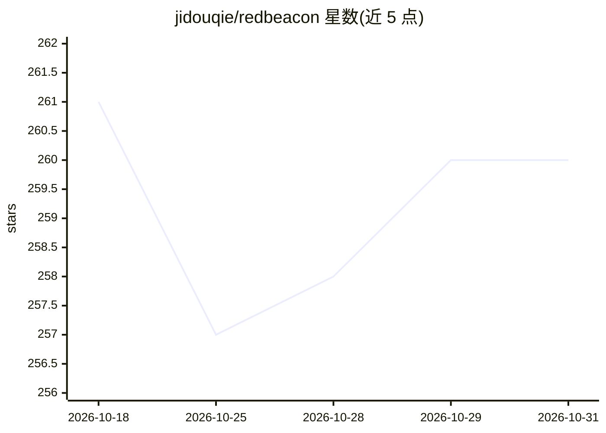

# jidouqie/redbeacon

⭐ 260 · Shell · NOASSERTION · 推送 2026-10-28 · [GitHub](https://github.com/jidouqie/redbeacon) · [官网](https://bytestaff.jiomig.com/market/redbeacon) · 组织维护 · 中文 README

**小红书运营数字员工：定位、选题、生成、审稿、发布全流程**

面向小红书运营创作者的本机数字员工：多账号管理与扫码登录、对标账号学习、单篇笔记风格提炼、生成选题与文案及 AI 封面，成稿经本机审稿台人工通过后发布，发布均由用户前台主动触发。可通过 Claude Code、Codex、OpenClaw、Hermes、腾讯 WorkBuddy 等 AI 助手协作，也可仅用桌面客户端。业务数据默认保存在本机；ByteStaff 平台提供账号身份与 AI 能力。macOS（Apple Silicon）与 Windows 10/11 提供官网脚本安装，GitHub 仓库仅作产品介绍与安装入口，不发布客户端源码。

## 筛选速览

| 维度 | 判定 | 备注 |
|---|---|---|
| AI 角色 | `ai-native` | 本体是模型或模型工具 |
| 许可风险 | `none` | NOASSERTION |
| 部署形态 | `None` |  |
| 模型依赖 | — | README 未给出锁定关系 |
| 硬件要求 | — | 无带数字的原话,不猜 |
| 安装摩擦 | `low` | 无编译、无系统依赖或容器化 |
| 成熟度 | — | 结构信号不足 |

## 能力要点

- 账号定位、选题、文案与封面生成串成一条工作流
- 对标账号与单篇笔记风格学习，沉淀可复用内容方案
- 本机审稿台：未经用户确认不会自动发布
- 支持 Claude Code、Codex、OpenClaw 等 AI 助手协作或纯桌面客户端使用

## 适用场景

- 在一台电脑上管理多个小红书账号并生成内容
- 学习对标账号的定位与文案方法后生成方案
- 经人工审稿后在小红书发布笔记

## 场景标签

`工作流自动化` `AI 写作` · 领域:效率与自动化

## 证据(README 行号)

> L3: RedBeacon 是一款面向小红书运营的本机数字员工。它把账号定位、选题规划、文案与封面生成、本机审稿和发布串成一条可见、可控的工作流，让创作者把时间放在方向和判断上。
> L12: - **选题、文案与封面**：围绕账号定位生成选题和笔记，支持 AI 封面、文字卡片以及组合配图。

## 星数曲线

2026-10-18 261 → 2026-10-31 260（-1）

---
*卡片 v1 · prompt 1.4 · 生成 2026-10-22 · 置信度 high · 依据 README sha `d6a4d8d4c1eb` · [字段定义](../../DATASET.md)*
