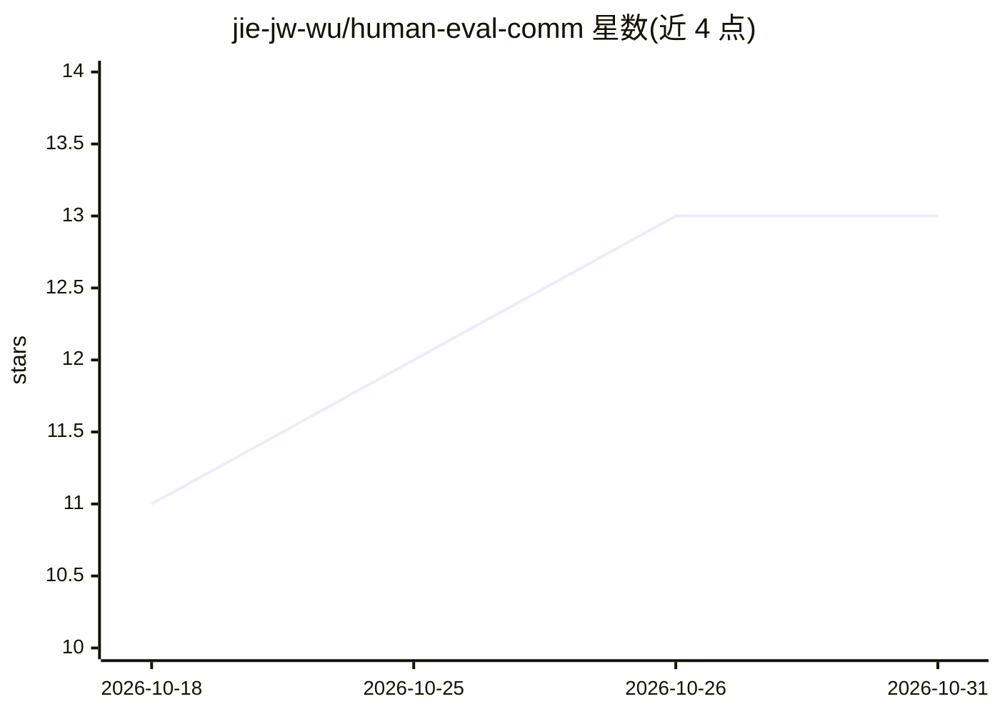

# jie-jw-wu/human-eval-comm

⭐ 13 · Python · 推送 2026-02-08 · [GitHub](https://github.com/jie-jw-wu/human-eval-comm) · 组织维护

**评测代码 LLM 提澄清问题能力的基准数据集（762 条）**

基于 HumanEval 构建的基准数据集与评测流程：将 164 个原题的描述按歧义、矛盾、不完整三类修改并人工核验，得到 762 条会触发澄清需求的新题，用于衡量 LLM 与 LLM Agent 在需求不明确时提出澄清问题的能力。评测分 7 个阶段（phase 0-6），由脚本驱动，LLM 评估器需设置 OPENAI_KEY，推理阶段（phase 0/2）需 GPU，其余阶段可在 CPU 运行；提供 Linux 与 sbatch 集群脚本。另附带多轮结构的 Okanagan 代码澄清与生成 Agent 及多模型评测结果。

## 筛选速览

| 维度 | 判定 | 备注 |
|---|---|---|
| AI 角色 | `ai-knowledge` | 知识聚合/清单类 |
| 许可风险 | `none` | — |
| 部署形态 | `library` | 以包/库形式分发 |
| 模型依赖 | — | README 未给出锁定关系 |
| 硬件要求 | — | 无带数字的原话,不猜 |
| 安装摩擦 | `low` | 无编译、无系统依赖或容器化 |
| 成熟度 | — | 结构信号不足 |

## 能力要点

- 762 条人工核验的修改题，覆盖歧义/矛盾/不完整三种澄清类型及组合
- 7 阶段评测流程：推理→LLM 评估→二轮生成→测试→指标聚合
- Okanagan：面向代码澄清提问的多轮 LLM Agent
- 附 Pass@1、Test Pass Rate、通信率、好问题率的多模型结果表

## 适用场景

- 评测代码 LLM 或 Agent 面对含糊需求时是否会提问
- 对比不同模型在通信率与代码正确率上的表现
- 研究歧义/矛盾/不完整需求对代码生成的影响

## 场景标签

`模型评测` · 领域:评测与运维

## 证据(README 行号)

> L1: # HumanEvalComm: Benchmarking the Communication Skills of Code Generation for LLMs and LLM Agent
> L15: HumanEvalComm is a benchmark dataset for evaluating the communication skills of Large Language Models (LLMs) in cod

## 星数曲线

2026-10-18 11 → 2026-10-31 13（+2）

---
*卡片 v1 · prompt 1.4 · 生成 2026-10-31 · 置信度 high · 依据 README sha `1cc69f0048bd` · [字段定义](../../DATASET.md)*
