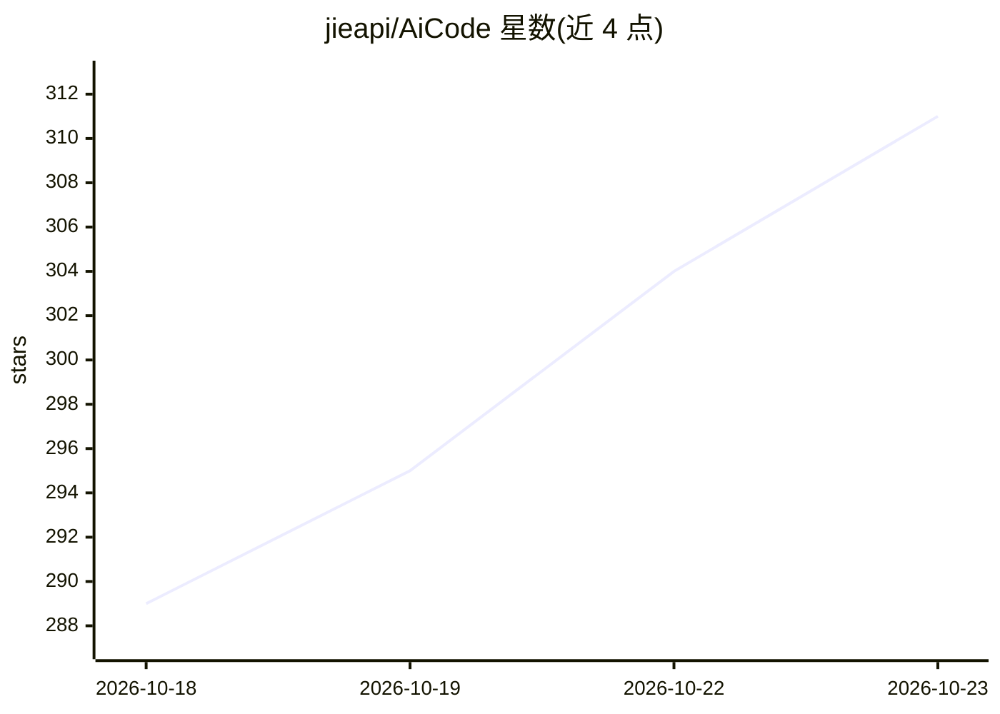

# jieapi/AiCode

⭐ 311 · Kotlin · GPL-3.0 · 推送 2026-10-22 · [GitHub](https://github.com/jieapi/AiCode) · [官网](https://aicode.murk.top) · 个人维护 · 中文 README

**Android 上的 AI 编程 Agent，内置 Linux 容器与代码编辑器**

运行在 Android 设备上的通用 AI Coding Agent 应用：基于 Termux 与 PRoot 提供内置 Alpine Linux 容器与终端，AI Agent 可读写文件、执行 Shell 命令与构建工具，本地完成写码、调试与构建；也可切换远程 SSH 服务器作为执行后端。不内置模型、不绑定供应商，兼容 OpenAI / Anthropic / Gemini 三类协议并支持自定义供应商与多 Key 轮换；支持 MCP 协议扩展、子代理并行、检查点回滚、Git 可视化管理与平板适配。通过 GitHub Releases 分发 APK，面向不用电脑也想进行软件开发的移动用户。

## 筛选速览

| 维度 | 判定 | 备注 |
|---|---|---|
| AI 角色 | `ai-native` | 本体是模型或模型工具 |
| 许可风险 | `viral` | GPL-3.0 |
| 部署形态 | `None` |  |
| 模型依赖 | — | README 未给出锁定关系 |
| 硬件要求 | — | 无带数字的原话,不猜 |
| 安装摩擦 | `low` | 无编译、无系统依赖或容器化 |
| 成熟度 | — | 结构信号不足 |

## 能力要点

- Termux+PRoot 内置 Alpine Linux 容器，AI Agent 可读写文件、执行 Shell 与构建
- 兼容 OpenAI / Anthropic / Gemini 协议，模型、密钥与端点自行配置，支持多 Key 轮换
- 支持本地（stdio）与远程（HTTP）MCP 服务器扩展 AI 工具
- 远程 SSH 模式将远程服务器作为执行后端

## 适用场景

- 在手机上不依赖电脑完成写码、调试与构建
- 把手机作为远程 SSH 项目的移动工作站
- 通过 MCP 服务器扩展 AI Agent 的工具能力

## 场景标签

`编码 Agent` · 领域:编码与开发

## 证据(README 行号)

> L26: AiCode 是运行在 Android 上的通用 AI Coding Agent，把一套完整的 Linux 开发环境装进手机：内置 Alpine Linux 容器与终端，AI Agent 能读写文件、执行 Shell 命令、运行构
> L28: 上手无需任何准备：装上 App、在「AI 供应商」配好模型即可直接开发，不用电脑，也不用自己搭建环境。AiCode 不内置模型、不绑定供应商，支持 OpenAI / Anthropic / Gemini 三类协议与自定义供应商，模

## 星数曲线

2026-10-18 289 → 2026-10-23 311（+22）

---
*卡片 v1 · prompt 1.4 · 生成 2026-10-21 · 置信度 high · 依据 README sha `5ee71d163a10` · [字段定义](../../DATASET.md)*
