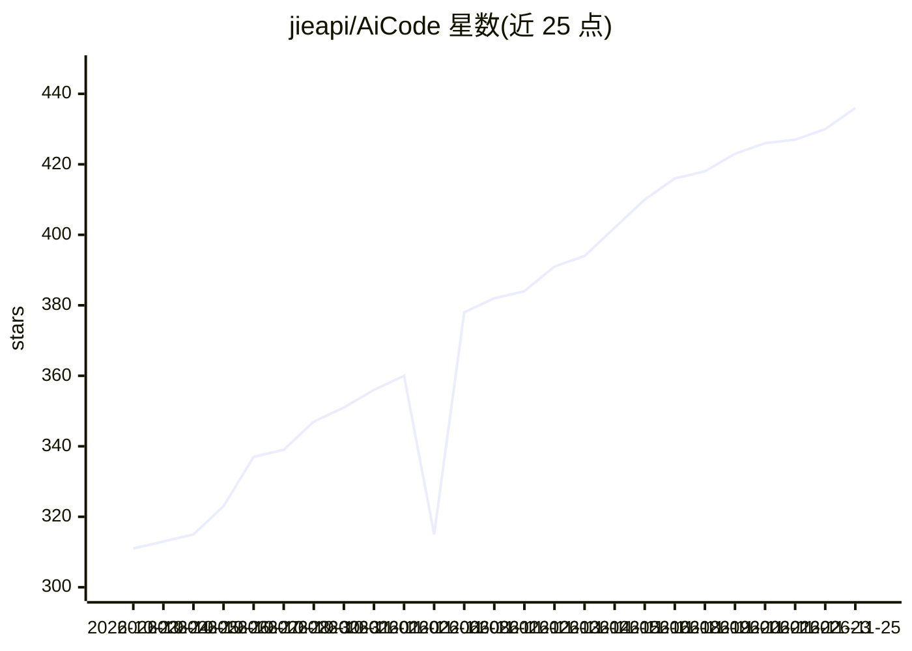

# jieapi/AiCode

⭐ 436 · Kotlin · GPL-3.0 · 推送 2026-11-23 · [GitHub](https://github.com/jieapi/AiCode) · [官网](https://aicode.murk.top) · 个人维护 · 中文 README

**Android 上的 AI 编程 Agent：手机本地 Linux 环境写代码调试构建**

运行在 Android 上的通用 AI Coding Agent，内置基于 Termux 与 PRoot 的 Alpine Linux 容器与多标签终端，Agent 可读写文件、执行 Shell 命令、运行构建工具；也可切换远程 SSH 服务器作为执行后端。不内置模型、不绑定供应商，支持 OpenAI/Anthropic/Gemini 三类协议与自定义供应商，配好多模型即可使用。功能覆盖子代理并行、三种权限模式、检查点回滚、MCP 工具扩展、Git 可视化、代码编辑器与 SFTP 同步。提供 GitHub Releases 的 APK 安装包，需 Android 8.0+。

## 筛选速览

| 维度 | 判定 | 备注 |
|---|---|---|
| AI 角色 | `ai-native` | 本体是模型或模型工具 |
| 许可风险 | `viral` | GPL-3.0 |
| 部署形态 | `None` |  |
| 模型依赖 | — | README 未给出锁定关系 |
| 硬件要求 | — | 无带数字的原话,不猜 |
| 安装摩擦 | `low` | 无编译、无系统依赖或容器化 |
| 成熟度 | — | 结构信号不足 |

## 能力要点

- 内置 Alpine Linux 容器与终端，代码编写到构建在手机本地完成
- 兼容 OpenAI/Anthropic/Gemini 协议，模型、密钥、端点自行配置，多 Key 轮换
- 支持 MCP 协议连接本地与远程服务器动态扩展工具
- 检查点快照一键回滚代码与对话，BUILD/PLAN/AUTO 三种权限模式

## 适用场景

- 没有电脑时用手机完成写代码、调试与构建
- 通过 SSH 把手机当作远程项目的移动工作站
- 连接 MCP 服务器扩展 Agent 的工具能力

## 场景标签

`编码 Agent` · 领域:编码与开发

## 证据(README 行号)

> L29: AiCode 是运行在 Android 上的通用 AI Coding Agent，把一套完整的 Linux 开发环境装进手机：内置 Alpine Linux 容器与终端，AI Agent 能读写文件、执行 Shell 命令、运行构
> L31: 上手无需任何准备：装上 App、在「AI 供应商」配好模型即可直接开发，不用电脑，也不用自己搭建环境。AiCode 不内置模型、不绑定供应商，支持 OpenAI / Anthropic / Gemini 三类协议与自定义供应商，模
> L61: - **协议兼容** — 兼容 OpenAI / Anthropic / Gemini 三类协议，内置多家官方预设，也支持自定义供应商，模型列表与单价可自定义

## 星数曲线

2026-10-23 311 → 2026-11-25 436（+125）

---
*卡片 v1 · prompt 1.4 · 生成 2026-11-25 · 置信度 high · 依据 README sha `44a499c3f39f` · [字段定义](../../DATASET.md)*
