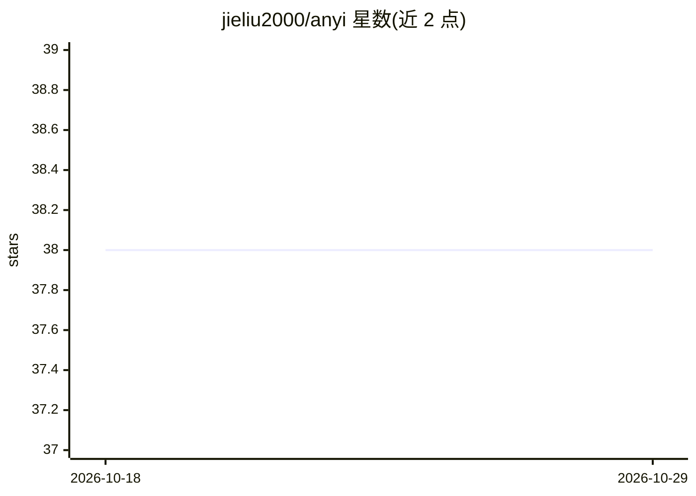

# jieliu2000/anyi

⭐ 38 · Go · Apache-2.0 · 推送 2026-03-10 · [GitHub](https://github.com/jieliu2000/anyi) · 个人维护 · 中文 README

**Go 语言自主 AI agent 框架：统一接口接入多家 LLM 构建工作流**

面向 Go 开发者的自主 AI agent 框架，通过统一 API 接入 OpenAI、Azure OpenAI、Anthropic、Zhipu AI、阿里云灵积、Ollama、DeepSeek、SiliconCloud 等多家 LLM 提供商。核心机制为工作流系统：步骤链接配合验证与自动重试，内置 LLMExecutor、命令执行器、条件分支、MCP 执行器等组件，以及字符串/JSON 验证器。支持 YAML/JSON/TOML 配置驱动开发与多模态输入，需 Go 1.20+。

## 筛选速览

| 维度 | 判定 | 备注 |
|---|---|---|
| AI 角色 | `ai-ecosystem` | LLM/agent 周边工具 |
| 许可风险 | `permissive` | Apache-2.0 |
| 部署形态 | `None` |  |
| 模型依赖 | local-ok | 支持本地模型 |
| 硬件要求 | — | 无带数字的原话,不猜 |
| 安装摩擦 | `low` | 无编译、无系统依赖或容器化 |
| 成熟度 | — | 结构信号不足 |

## 能力要点

- 统一 API 接入 8 家 LLM 提供商（含 Ollama 本地部署）
- 工作流步骤链接、验证与自动重试机制
- YAML/JSON/TOML 配置驱动定义客户端与工作流
- 内置 MCP 执行器访问外部模型、资源与工具

## 适用场景

- 用 Go 构建带重试与验证的生产级 AI 服务
- 按成本或能力为不同任务选用不同模型
- 通过配置文件快速搭建多步 AI 工作流原型

## 场景标签

`Agent 框架` · 领域:Agent 开发

## 证据(README 行号)

> L10: Anyi is a powerful autonomous AI agent framework that helps you build AI solutions that seamlessly integrate with r
> L14: - **Universal LLM Access** - Connect to multiple LLM providers (OpenAI, Anthropic, etc.) through a consistent API
> L15: - **Powerful Workflow System** - Chain steps together with validation and automatic retries for robust AI pipelines

## 星数曲线

2026-10-18 38 → 2026-10-29 38（+0）

---
*卡片 v1 · prompt 1.4 · 生成 2026-10-25 · 置信度 high · 依据 README sha `51c2a03da4cd` · [字段定义](../../DATASET.md)*
