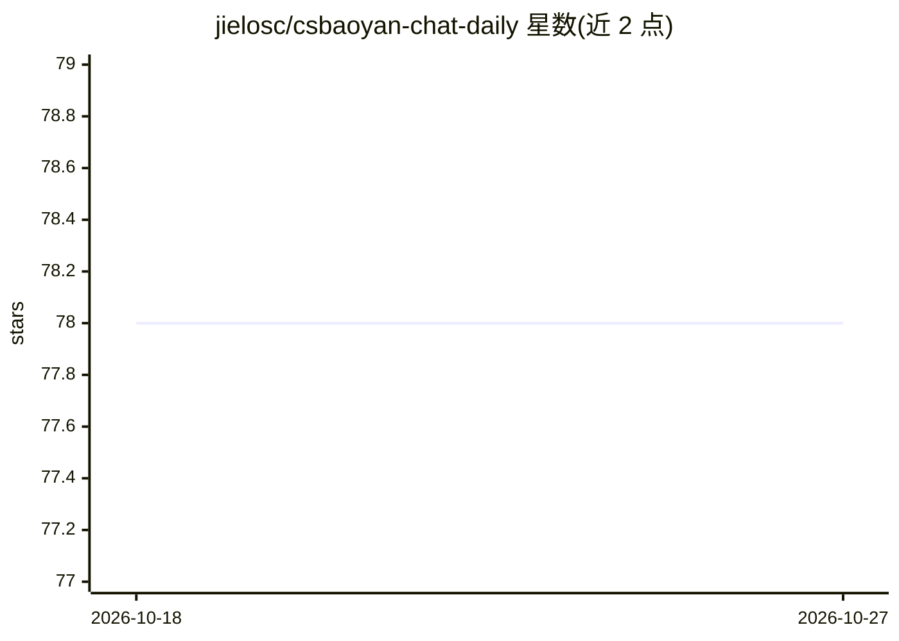

# jielosc/csbaoyan-chat-daily

⭐ 78 · Python · MIT · 推送 2026-10-10 · [GitHub](https://github.com/jielosc/csbaoyan-chat-daily) · [官网](https://csbaoyan.icelon.top) · 个人维护 · 中文 README

**CS 保研群聊 AI 日报生成工具：ChatLab 记录转结构化 Markdown 日报**

面向 CS 保研场景的工具：读取 ChatLab JSON 群聊导出，经匿名化（发送者、联系方式、链接）、分块提取（带内部证据编号）与板块编辑校验，由程序确定性渲染为四个板块的 Markdown 日报。模型调用使用 OpenAI 兼容 API，可为最终编辑阶段单独配置模型。输入边界是 ChatLab JSON，本身不读取 QQ 数据库；可选集成 QQ 自动导出（macOS）、Cloudflare R2、Telegram 播报与定时任务。公开日报已停止每日更新，工具仍可自行部署使用；发布前需人工复核隐私。

## 筛选速览

| 维度 | 判定 | 备注 |
|---|---|---|
| AI 角色 | `ai-ecosystem` | LLM/agent 周边工具 |
| 许可风险 | `permissive` | MIT |
| 部署形态 | `None` |  |
| 模型依赖 | — | README 未给出锁定关系 |
| 硬件要求 | — | 无带数字的原话,不猜 |
| 安装摩擦 | `low` | 无编译、无系统依赖或容器化 |
| 成熟度 | — | 结构信号不足 |

## 能力要点

- ChatLab JSON → 清洗匿名化 → 分块提取 → 板块编辑校验 → Markdown 日报的流水线
- 内部证据编号与校验命令，检查引用范围与时间线覆盖
- 模型调用前匿名化发送者与联系方式，输出执行结构与隐私风险检查
- 可选集成 QQ 自动导出、Cloudflare R2、Telegram 与定时任务流水线

## 适用场景

- 我把保研群一天的聊天记录整理成结构化日报，快速抓住院校与申请信息
- 我想自行部署一套群聊日报生成与自动发布流水线
- 我需要按板块归档群聊中的讨论脉络与待核实传闻

## 场景标签

`AI 写作` · 领域:内容生成

## 证据(README 行号)

> L14: 将 ChatLab 群聊记录经过匿名化、AI 提取与校验，整理为四个板块的 Markdown 日报
> L106: **ChatLab JSON → 清洗与匿名化 → 分块提取 → 板块编辑与校验 → Markdown 日报**
> L29: - **模型服务可配置**：使用 OpenAI 兼容 API，可为最终编辑阶段单独配置模型。

## 星数曲线

2026-10-18 78 → 2026-10-27 78（+0）

---
*卡片 v1 · prompt 1.4 · 生成 2026-10-24 · 置信度 high · 依据 README sha `66cb5b825d89` · [字段定义](../../DATASET.md)*
