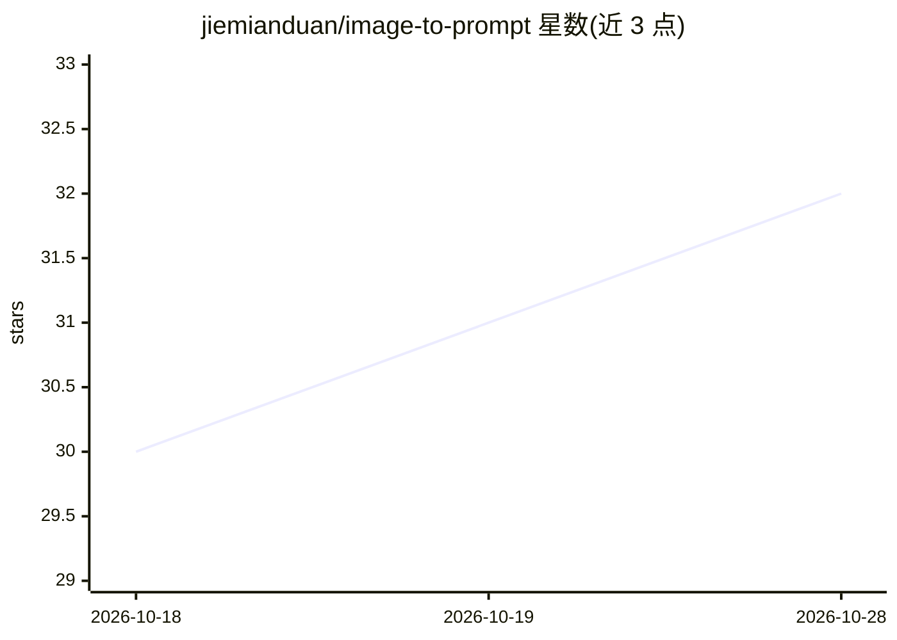

# jiemianduan/image-to-prompt

⭐ 32 · MIT · 推送 2026-08-07 · [GitHub](https://github.com/jiemianduan/image-to-prompt) · 个人维护 · 中文 README

**从参考图重建可复用文生图提示词的 Agent 技能**

面向 Codex 与 Cursor 的开源 Agent Skill：通过可见证据分析参考图（主体、构图、光线、色彩、材质、风格），生成中英文重建提示词、负面提示词与推荐起始参数，并针对 Midjourney、Stable Diffusion、SDXL、FLUX、DALL-E 提供模型专属写法。明确声明不尝试还原原始提示词、种子、模型或 LoRA 等未记录的生成设置。安装方式为 git clone 到 Codex 技能目录或复制 Cursor 命令文件。

## 筛选速览

| 维度 | 判定 | 备注 |
|---|---|---|
| AI 角色 | `ai-knowledge` | 知识聚合/清单类 |
| 许可风险 | `permissive` | MIT |
| 部署形态 | `None` |  |
| 模型依赖 | — | README 未给出锁定关系 |
| 硬件要求 | — | 无带数字的原话,不猜 |
| 安装摩擦 | `low` | 无编译、无系统依赖或容器化 |
| 成熟度 | — | 结构信号不足 |

## 能力要点

- 基于可见证据区分观察与推断，重建中英文提示词
- 针对 Midjourney/Stable Diffusion/SDXL/FLUX/DALL-E 的模型专属提示词指导
- 生成负面提示词、推荐起始参数及含可替换值的完整可编辑提示词
- 支持摄影、插画、3D 渲染、UI 截图等 7 类图像

## 适用场景

- 拿到一张参考图，想反向得到可用于文生图模型的提示词
- 为不同文生图模型生成对应格式的提示词与参数
- 在 Codex 或 Cursor 中以命令调用图像转提示词能力

## 场景标签

`提示工程` · 领域:Agent 开发

## 证据(README 行号)

> L3: An open Agent Skill for reconstructing faithful, reusable image-generation prompts from reference images.
> L7: This skill analyzes one or more images from visible evidence and produces practical prompts for image-generation mod

## 星数曲线

2026-10-18 30 → 2026-10-28 32（+2）

---
*卡片 v1 · prompt 1.4 · 生成 2026-10-26 · 置信度 mid · 依据 README sha `ed7d225e912b` · [字段定义](../../DATASET.md)*
