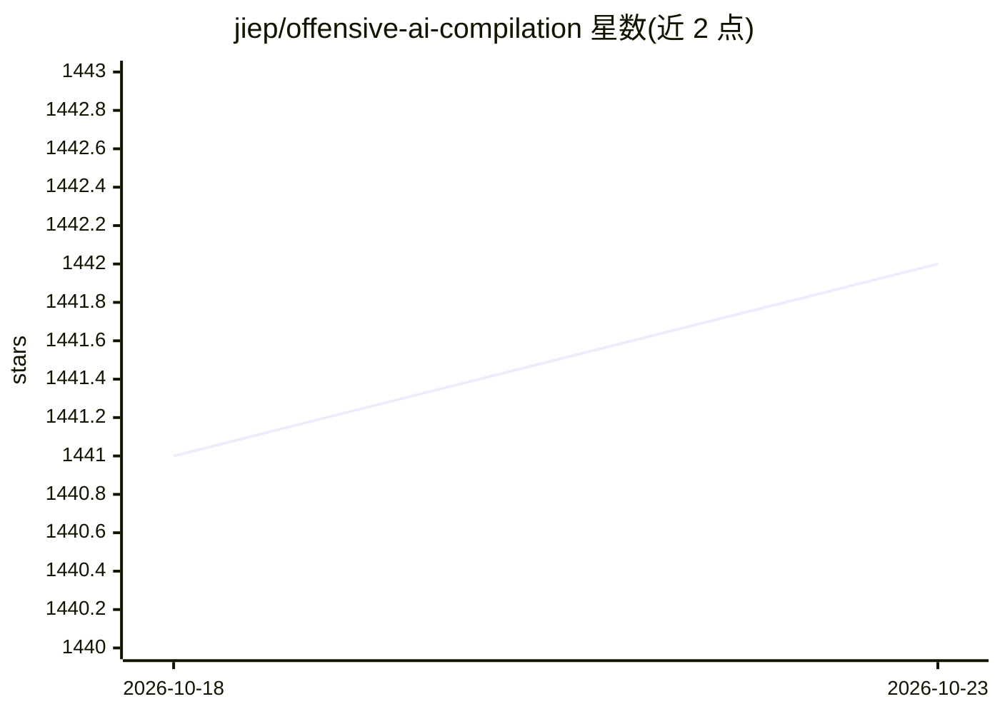

# jiep/offensive-ai-compilation

⭐ 1,442 · HTML · CC-BY-SA-4.0 · 推送 2026-10-03 · [GitHub](https://github.com/jiep/offensive-ai-compilation) · [官网](https://jiep.github.io/offensive-ai-compilation/) · 个人维护

**Offensive AI 资源策展清单：攻击与防御论文/工具汇编**

一个围绕 Offensive AI（对抗性机器学习滥用方向）的策展资源清单：按 Abuse 分类组织，覆盖 Adversarial Machine Learning 四类攻击（提取、反演/推断、投毒/后门、逃逸），每类附攻击原理说明、防御措施列表与论文/工具链接，如模型窃取、成员推断、BadNets 后门、FGSM/Carlini & Wagner 对抗样本等；还含 prompt injection 防御与越狱状态等 LLM 相关条目。面向 AI 安全研究者与红队/攻防学习者，仅收录链接与简介，不含可运行代码。

## 筛选速览

| 维度 | 判定 | 备注 |
|---|---|---|
| AI 角色 | `ai-knowledge` | 知识聚合/清单类 |
| 许可风险 | `viral` | CC-BY-SA-4.0 |
| 部署形态 | `None` |  |
| 模型依赖 | — | README 未给出锁定关系 |
| 硬件要求 | — | 无带数字的原话,不猜 |
| 安装摩擦 | `low` | 无编译、无系统依赖或容器化 |
| 成熟度 | — | 结构信号不足 |

## 能力要点

- 按提取/反演/投毒/逃逸四类攻击组织的分类体系
- 每类攻击附防御措施与论文/工具链接汇编
- 覆盖 LLM 相关条目（prompt injection 防御、GPT 越狱状态、训练数据提取）

## 适用场景

- 系统性查找对抗性机器学习攻击与防御的论文和工具
- 学习模型提取、成员推断、后门、对抗样本等攻击类型的原理
- 跟踪 LLM 安全（prompt injection、越狱）相关资源

## 场景标签

`精选清单` `网络安全` · 领域:学习与行业

## 证据(README 行号)

> L3: A curated list of useful resources that cover Offensive AI.
> L18: It is organized into four types of attacks: extraction, inversion, poisoning and evasion.

## 星数曲线

2026-10-18 1,441 → 2026-10-23 1,442（+1）

---
*卡片 v1 · prompt 1.4 · 生成 2026-10-21 · 置信度 high · 依据 README sha `49bff4e470ec` · [字段定义](../../DATASET.md)*
