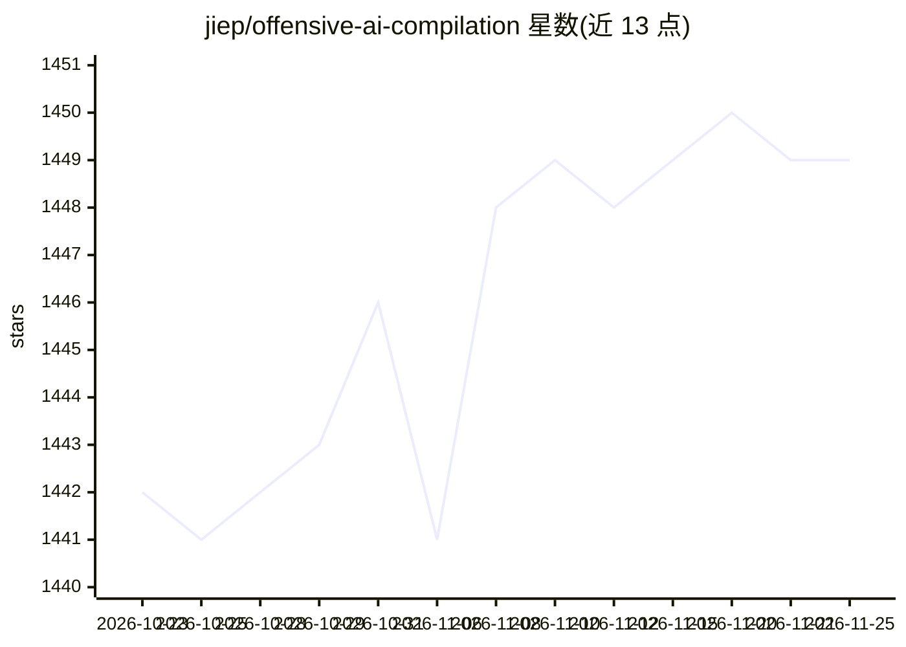

# jiep/offensive-ai-compilation

⭐ 1,449 · HTML · CC-BY-SA-4.0 · 推送 2026-11-01 · [GitHub](https://github.com/jiep/offensive-ai-compilation) · [官网](https://jiep.github.io/offensive-ai-compilation/) · 个人维护

**Offensive AI 资源策展清单：攻击与防御论文/工具集**

一个关于 Offensive AI 的资源聚合清单，围绕 AI 模型漏洞利用组织内容：按对抗机器学习四类攻击（模型窃取/extraction、推断/inversion、投毒/poisoning、逃逸/evasion）逐类给出攻击机制说明、限制条件、防御措施与论文链接。条目覆盖白盒/黑盒攻击、成员推断、后门植入、FGSM 等常见逃逸攻击及相应防御（差分隐私、对抗训练、Neural Cleanse 等），并收录部分相关开源工具箱与追踪仓库。受众为研究 AI 安全攻防的读者。

## 筛选速览

| 维度 | 判定 | 备注 |
|---|---|---|
| AI 角色 | `ai-knowledge` | 知识聚合/清单类 |
| 许可风险 | `viral` | CC-BY-SA-4.0 |
| 部署形态 | `None` |  |
| 模型依赖 | — | README 未给出锁定关系 |
| 硬件要求 | — | 无带数字的原话,不猜 |
| 安装摩擦 | `low` | 无编译、无系统依赖或容器化 |
| 成熟度 | — | 结构信号不足 |

## 能力要点

- 按 extraction/inversion/poisoning/evasion 四类攻击结构化组织
- 每类攻击附防御措施与论文链接
- 收录 BadNets、FGSM、C&W 等代表性攻击与防御资源
- 含部分开源工具箱（BackdoorBox、Backdoor Toolbox 等）与追踪仓库链接

## 适用场景

- 系统学习 AI 模型窃取、成员推断、投毒与逃逸攻击的原理与文献
- 为对抗鲁棒性研究查找防御方法的参考资料
- 了解 LLM 提示注入、越狱等新兴攻击的资源入口

## 场景标签

`网络安全` `科研工具` `精选清单` · 领域:学习与行业

## 证据(README 行号)

> L3: A curated list of useful resources that cover Offensive AI.
> L12: ### 🧠 Adversarial Machine Learning 🧠
> L18: It is organized into four types of attacks: extraction, inversion, poisoning and evasion.

## 星数曲线

2026-10-23 1,442 → 2026-11-25 1,449（+7）

---
*卡片 v1 · prompt 1.4 · 生成 2026-11-23 · 置信度 high · 依据 README sha `05709ffb1e93` · [字段定义](../../DATASET.md)*
