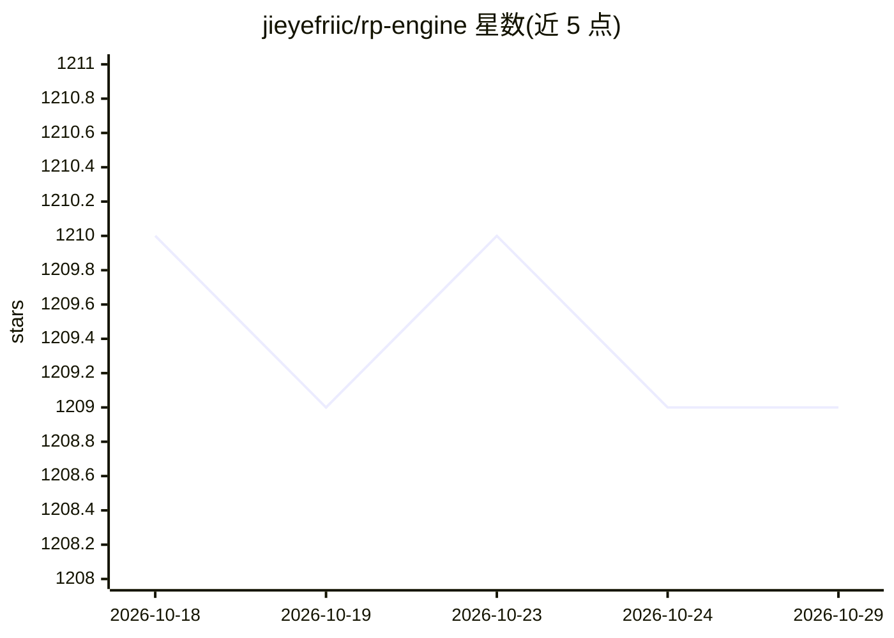

# jieyefriic/rp-engine

⭐ 1,209 · Rust · Apache-2.0 · 推送 2026-10-21 · [GitHub](https://github.com/jieyefriic/rp-engine) · [官网](https://crates.io/crates/riceprompt-engine) · 组织维护 · 中文 README

**Rust 编写的 YAML 原生 agent 工作流执行引擎，供开发者编排 LLM 任务**

以 YAML 声明式文件描述 agent 工作流（节点、边、提示词、数据源、MCP 工具），引擎解析文件、解析依赖并执行图：发起 LLM 调用、运行 Rhai 脚本、查询数据库、调用 MCP 工具、迭代数据与编排多 agent 计划。面向构建 agent 应用的开发者，以 Rust crate 形式提供。它是 RicePrompt 可视化 agent IDE 的底层引擎。当前处于 0.1.x 阶段，API 可能在次版本间变化，需稳定性时应锁定精确版本。

## 筛选速览

| 维度 | 判定 | 备注 |
|---|---|---|
| AI 角色 | `ai-ecosystem` | LLM/agent 周边工具 |
| 许可风险 | `permissive` | Apache-2.0 |
| 部署形态 | `None` |  |
| 模型依赖 | locked-api |  |
| 硬件要求 | — | 无带数字的原话,不猜 |
| 安装摩擦 | `low` | 无编译、无系统依赖或容器化 |
| 成熟度 | `idea` | |

## 能力要点

- 单文件 YAML 描述完整工作流（图、提示词、数据源、provider）
- 多 provider LLM 支持：OpenAI、Anthropic、Gemini、DeepSeek、Qwen 等及 OpenAI 兼容端点
- 节点类型含 generate、transform（Rhai）、supervisor（多 agent 路由）、mcp/mcp_tools 等
- 内置数据连接器：PostgreSQL、MySQL、MongoDB、Redis、Qdrant、S3 兼容存储、REST API
- 长时任务的 checkpoint / resume 暂停恢复

## 适用场景

- 用声明式 YAML 定义并执行多步骤 LLM agent 工作流
- 编排多 agent 计划并路由任务（supervisor 节点）
- 在 Rust 应用中嵌入工作流执行能力

## 场景标签

`Agent 框架` `多智能体` `工作流自动化` · 领域:Agent 开发

## 证据(README 行号)

> L3: YAML-native agent workflow execution engine, written in Rust.
> L6: sources, MCP tools — and the engine parses it, resolves dependencies, and
> L7: executes the graph: making LLM calls, running scripts, querying databases,

## 星数曲线

2026-10-18 1,210 → 2026-10-29 1,209（-1）

---
*卡片 v1 · prompt 1.4 · 生成 2026-10-21 · 置信度 high · 依据 README sha `274dc78e3f4a` · [字段定义](../../DATASET.md)*
