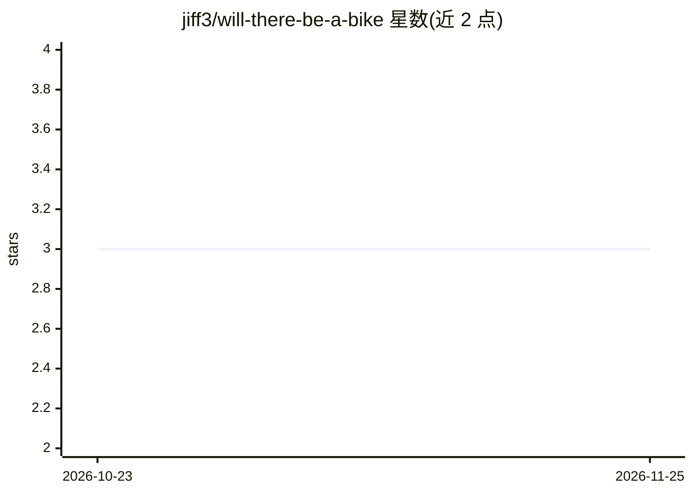

# jiff3/will-there-be-a-bike

⭐ 3 · Python · MIT · 推送 2026-10-10 · [GitHub](https://github.com/jiff3/will-there-be-a-bike) · 个人维护

**为通勤者预测 Citi Bike 站点余车/余位的网络应用**

结合官方 Citi Bike 实时观测、站点级需求预测与可解释的替代建议的自行车共享应用，覆盖存档通勤、实测库存监控与历史骑行回放。预测以 30/60 分钟为尺度，按时序分段进行模型选择与校准，部署季节基线模型（CPU LightGBM 为候选），显式展示低置信度与非校准边界。架构为 React/FastAPI/PostgreSQL-PostGIS 模块化单体，离线演示经 Docker Compose 运行，无公开部署实例。

## 筛选速览

| 维度 | 判定 | 备注 |
|---|---|---|
| AI 角色 | `ai-native` | 本体是模型或模型工具 |
| 许可风险 | `permissive` | MIT |
| 部署形态 | `self-host` | docker 或自建部署 |
| 模型依赖 | — | README 未给出锁定关系 |
| 硬件要求 | — | 无带数字的原话,不猜 |
| 安装摩擦 | `low` | 无编译、无系统依赖或容器化 |
| 成熟度 | — | 结构信号不足 |

## 能力要点

- 站点级 30/60 分钟需求预测与区间、可解释驱动因素及替代取还车站建议
- 950,604 条实测骑行数据上的时序模型评估，季节基线胜出并被部署
- 15 分钟粒度历史需求回放与时间线/播放控制
- Argon2id 账户、PostgreSQL 会话、CSRF 防护与站内提醒，无外部邮件/短信依赖

## 适用场景

- 查看附近 Citi Bike 站点余车余位并获取出发/到达预测
- 保存通勤路线并接收库存预警
- 回放城市历史骑行需求模式

## 场景标签

 · 领域:城市交通/出行工具

## 证据(README 行号)

> L33: - Server-side 30-/60-minute demand forecasts, count intervals, interpretable drivers, conservative inventory scenar
> L66: The reproduced experiment uses **950,604 valid observed rides**, **100 stations**, **566,400 station/15-minute rows

## 星数曲线

2026-10-23 3 → 2026-11-25 3（+0）

---
*卡片 v1 · prompt 1.4 · 生成 2026-11-21 · 置信度 mid · 依据 README sha `473de98ad529` · [字段定义](../../DATASET.md)*
