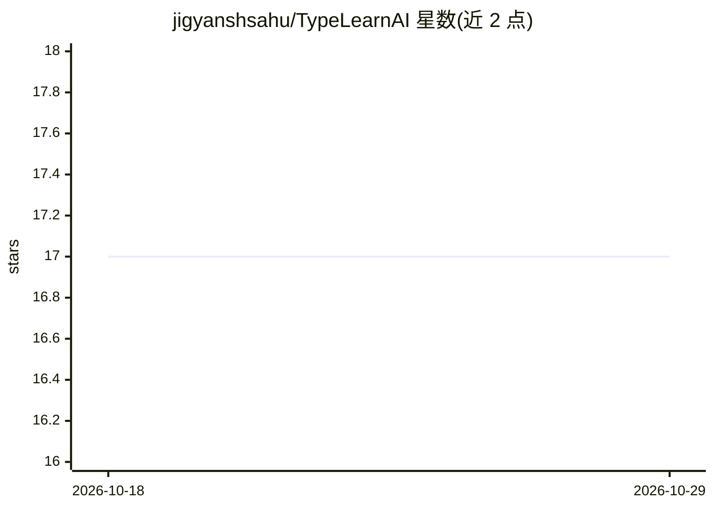

# jigyanshsahu/TypeLearnAI

⭐ 17 · TypeScript · 推送 2026-09-16 · [GitHub](https://github.com/jigyanshsahu/TypeLearnAI) · [官网](https://typequest-pro.vercel.app/) · 个人维护

**AI 生成练习文本的教育型打字练习 Web 应用**

基于 React/TypeScript/Vite 的打字练习应用：用户选择或输入任意主题，通过 Groq Cloud API（openai/gpt-oss-120b）按 Easy/Medium/Hard 难度生成教科书式段落作为打字内容，并自动清洗输出文本。提供 Timed/Words/Zen 三种模式、实时 WPM 遥测、Recharts 速度图表、15 个成就徽章与可分享成绩卡；历史与偏好全部存于浏览器 localStorage，不收集遥测。面向学生、程序员与知识学习者，需 Node.js 18+ 与 Groq API Key，从源码克隆构建运行。

## 筛选速览

| 维度 | 判定 | 备注 |
|---|---|---|
| AI 角色 | `ai-native` | 本体是模型或模型工具 |
| 许可风险 | `none` | — |
| 部署形态 | `library` | 以包/库形式分发 |
| 模型依赖 | locked-api |  |
| 硬件要求 | — | 无带数字的原话,不猜 |
| 安装摩擦 | `low` | 无编译、无系统依赖或容器化 |
| 成熟度 | — | 结构信号不足 |

## 能力要点

- 按任意主题经 Groq API 生成三档难度的教育段落
- Timed/Words/Zen 三种模式与实时 WPM/准确率遥测
- 15 个可解锁徽章与浏览器 localStorage 本地存储
- Canvas 生成可分享 PNG 成绩卡

## 适用场景

- 用自己正在学习的科目内容练习打字
- 追踪 WPM/准确率并解锁成就
- 生成成绩卡分享打字成绩

## 场景标签

 · 领域:教育/打字训练

## 证据(README 行号)

> L30: - **On-Demand Concept Generation**: Powered by **Groq Cloud API** (`openai/gpt-oss-120b`), generating informative, 
> L69: 2. **AI Content Generation**: Groq constructs an educational summary adhering to your formatting rules, word count,

## 星数曲线

2026-10-18 17 → 2026-10-29 17（+0）

---
*卡片 v1 · prompt 1.4 · 生成 2026-10-29 · 置信度 high · 依据 README sha `ec755289a437` · [字段定义](../../DATASET.md)*
