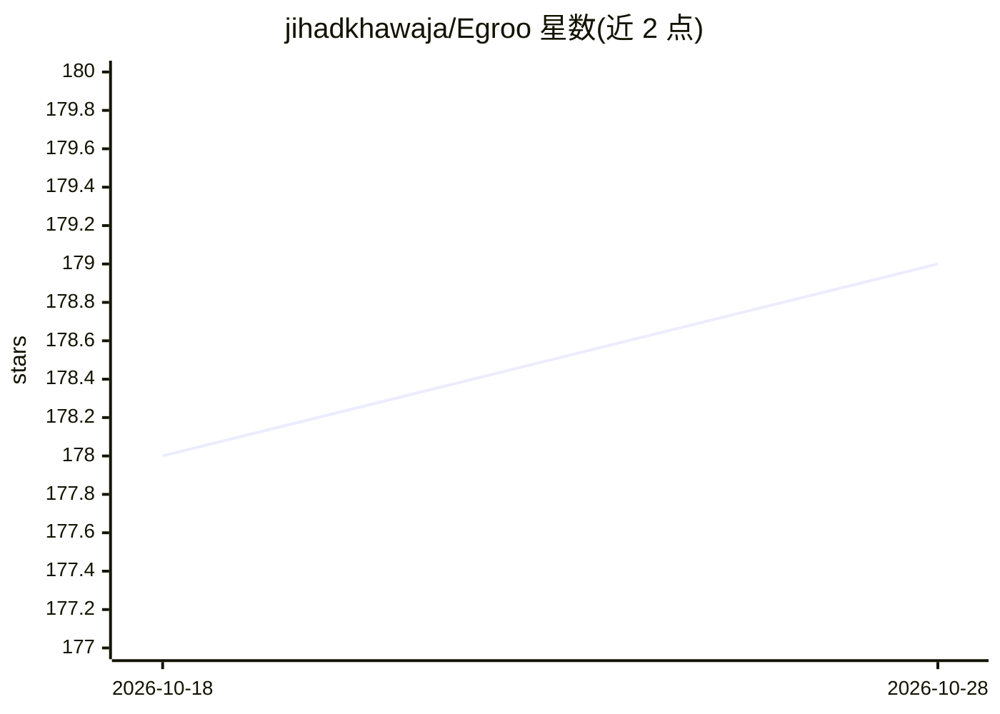

# jihadkhawaja/Egroo

⭐ 179 · C# · Apache-2.0 · 推送 2026-03-26 · [GitHub](https://github.com/jihadkhawaja/Egroo) · [官网](https://egroo.org) · 个人维护

**自托管实时聊天平台：端到端加密与频道语音通话，AI 代理可入群**

基于 Blazor、ASP.NET Core、SignalR 与 PostgreSQL 构建的自托管实时聊天平台，面向希望掌控基础设施与数据的团队。功能包括 SignalR 实时消息、按接收方的端到端加密（设备本地 RSA 密钥 + AES-GCM，服务器不持久保存明文）、送达确认后清除密文、频道内 WebRTC 语音通话（需配置 TURN 以跨 NAT）。AI 部分为可选代理：用户可创建、发布代理并加入频道，@提及时响应，支持 OpenAI、Azure OpenAI、Anthropic、Ollama。安装运行依赖 .NET 10 与 PostgreSQL，需自行编译，详细文档在 wiki。

## 筛选速览

| 维度 | 判定 | 备注 |
|---|---|---|
| AI 角色 | `ai-enhanced` | 去掉 AI 部分产品仍成立 |
| 许可风险 | `permissive` | Apache-2.0 |
| 部署形态 | `None` |  |
| 模型依赖 | local-ok | 支持本地模型 |
| 硬件要求 | — | 无带数字的原话,不猜 |
| 安装摩擦 | `medium` | 含编译或系统依赖之一 |
| 成熟度 | — | 结构信号不足 |

## 能力要点

- 按接收方的端到端加密与临时密文投递，服务器不保存消息明文
- 频道内 WebRTC 语音通话，服务器下发 ICE/TURN 配置
- AI 代理可作为频道成员参与对话（提及触发）
- Blazor Server/WebAssembly 双渲染与共享组件库

## 适用场景

- 团队搭建自主可控的私有聊天与语音平台
- 让 AI 代理加入频道并在被提及时回答问题
- 对消息隐私有要求、需要端到端加密的组织沟通

## 场景标签

`聊天机器人` · 领域:对话与助手

## 证据(README 行号)

> L5: Egroo is a self-hosted real-time chat platform built with Blazor, ASP.NET Core, SignalR, and PostgreSQL. It is desig
> L35: |AI agents|User-owned agents powered by OpenAI, Azure OpenAI, Anthropic, or Ollama|
> L143: Egroo supports personal AI agents that can be attached to channels and respond when mentioned. Agents can use supp

## 星数曲线

2026-10-18 178 → 2026-10-28 179（+1）

---
*卡片 v1 · prompt 1.4 · 生成 2026-10-22 · 置信度 high · 依据 README sha `47b0ccfa97bc` · [字段定义](../../DATASET.md)*
