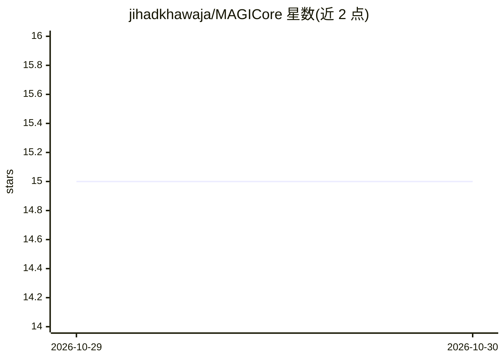

# jihadkhawaja/MAGICore

⭐ 15 · C# · Apache-2.0 · 推送 2026-09-05 · [GitHub](https://github.com/jihadkhawaja/MAGICore) · 个人维护

**面向 .NET AI agent 的长期记忆基础设施库**

本地优先的 C# 库，为 agent、助手、模拟与机器人提供长期记忆能力：语义层支持稠密/混合检索、重排序与多模态记忆；时间层提供审计历史、时间点读取与回滚；空间层支持 3D 观测、物体重建与动作片段记录。默认进程内运行、零配置、无遥测，通过 Microsoft.Extensions.AI / VectorData 抽象接入模型与向量存储，并提供 MCP 服务器示例。以 NuGet 包分发，需 .NET 环境。

## 筛选速览

| 维度 | 判定 | 备注 |
|---|---|---|
| AI 角色 | `ai-ecosystem` | LLM/agent 周边工具 |
| 许可风险 | `permissive` | Apache-2.0 |
| 部署形态 | `None` |  |
| 模型依赖 | local-ok | 支持本地模型 |
| 硬件要求 | — | 无带数字的原话,不猜 |
| 安装摩擦 | `medium` | 含编译或系统依赖之一 |
| 成熟度 | — | 结构信号不足 |

## 能力要点

- 语义/时间/空间三平面记忆：混合检索、审计回滚、3D 空间记忆
- 认知行为模式：Normal/Dreaming 后台记忆整合/Random Thoughts/Personal
- 基于 Microsoft.Extensions.AI 与 VectorData 的供应商中立持久化
- MCP 示例服务器暴露九个本地记忆工具

## 适用场景

- 为 .NET 构建的 AI agent 与助手添加跨会话长期记忆
- 机器人应用中记录与召回 3D 观测和动作片段
- 通过 MCP 客户端（如 Claude Desktop、Cursor）接入本地记忆工具

## 场景标签

`Agent 记忆` · 领域:Agent 开发

## 证据(README 行号)

> L5:  Long-term memory infrastructure for AI applications and agents in .NET.
> L15: MagiCore is a local-first C# library for building memory into agents, assistants, simulations, and robots. It combi
> L23: Everything runs in-process by default with no telemetry and no required hosted service. Production integrations use

## 星数曲线

2026-10-29 15 → 2026-10-30 15（+0）

---
*卡片 v1 · prompt 1.4 · 生成 2026-10-30 · 置信度 high · 依据 README sha `559d98ef3f97` · [字段定义](../../DATASET.md)*
