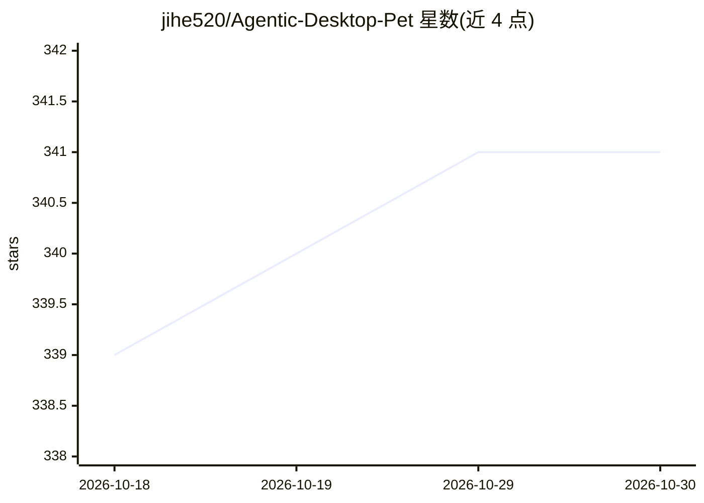

# jihe520/Agentic-Desktop-Pet

⭐ 341 · Python · 推送 2026-01-10 · [GitHub](https://github.com/jihe520/Agentic-Desktop-Pet) · 个人维护 · 中文 README

**带记忆、情感与 RPG 属性的 LLM 桌面宠物**

基于 Godot 4.3 前端与 Python FastAPI 后端的桌面宠物应用：接入 LLM API（OpenAI/DeepSeek/Claude 等）实现对话，用 Cognee 构建知识图谱记忆（长期记忆、语义搜索、实体关系提取），提供文件操作、代码执行、任务管理等类似 Claude Code 的个人助手能力，并有情感状态、RPG 属性/经验等级与 mod 主题系统。README 声明开发进行中、存在许多 Bug；需自行配置 LLM API Key，无打包发行版说明。

## 筛选速览

| 维度 | 判定 | 备注 |
|---|---|---|
| AI 角色 | `ai-native` | 本体是模型或模型工具 |
| 许可风险 | `none` | — |
| 部署形态 | `desktop` | 安装包/桌面程序 |
| 模型依赖 | — | README 未给出锁定关系 |
| 硬件要求 | — | 无带数字的原话,不猜 |
| 安装摩擦 | `low` | 无编译、无系统依赖或容器化 |
| 成熟度 | `idea` | |

## 能力要点

- Cognee 知识图谱记忆：长期记忆、语义搜索、记忆丰富化
- 类似 Claude Code 的助手能力：文件操作、代码执行、系统集成
- 情感系统（时间衰减、影响回复风格）与 RPG 属性/经验/好感度
- mod 系统支持切换桌宠主题（.pck 文件）

## 适用场景

- 让桌宠通过 LLM 对话并跨会话记住互动内容
- 用自然语言让桌宠读取/编辑本地文件、执行代码或管理待办
- 通过对话与任务培养角色属性和好感度

## 场景标签

`聊天机器人` `AI 助手` `Agent 记忆` `知识图谱` · 领域:Agent 开发

## 证据(README 行号)

> L9: 🚀 🚀 🚀 下一代 Agentic 桌宠 = LLM + 记忆 + 情感 + RPG + Claude Code
> L15: - 🧠 记忆系统：使用 Cognee
> L52: - **LLM API** (OpenAI / DeepSeek / Claude 等)

## 星数曲线

2026-10-18 339 → 2026-10-30 341（+2）

---
*卡片 v1 · prompt 1.4 · 生成 2026-10-21 · 置信度 high · 依据 README sha `85a48ee32784` · [字段定义](../../DATASET.md)*
