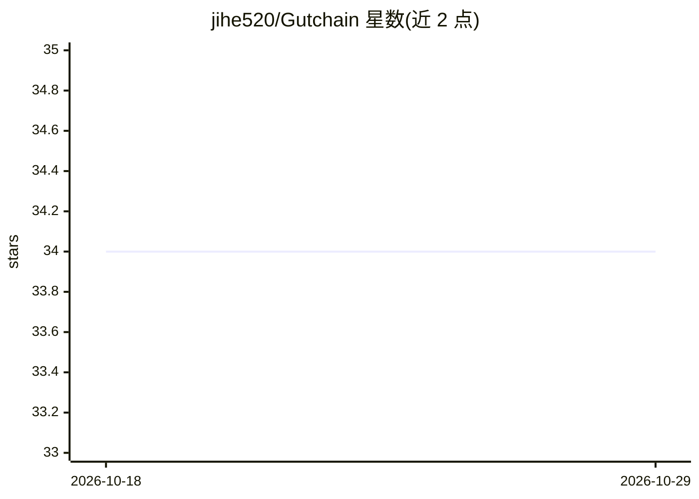

# jihe520/Gutchain

⭐ 34 · TypeScript · 推送 2026-08-18 · [GitHub](https://github.com/jihe520/Gutchain) · [官网](http://gutchain.fun) · 个人维护 · 中文 README

**Chrome 扩展：一键将 X 推文搬运到小红书创作页面**

Chrome 浏览器扩展，面向需要把海外社交媒体内容转发到中文平台的用户。工作流程：在 X（Twitter）页面点击 Gutchain 按钮，扩展自动截取推文图片、提取正文文本，然后将内容填入小红书创作页面，用户只需点击发布。以开发者模式加载已解压扩展的方式安装，安装包从 GitHub Releases 下载。作者另在开发一个社交媒体运营 Agent 项目。

## 筛选速览

| 维度 | 判定 | 备注 |
|---|---|---|
| AI 角色 | `ai-enhanced` | 去掉 AI 部分产品仍成立 |
| 许可风险 | `none` | — |
| 部署形态 | `None` |  |
| 模型依赖 | — | README 未给出锁定关系 |
| 硬件要求 | — | 无带数字的原话,不猜 |
| 安装摩擦 | `low` | 无编译、无系统依赖或容器化 |
| 成熟度 | — | 结构信号不足 |

## 能力要点

- 自动截取推文图片并提取正文
- 自动填入小红书创作页面，用户点击发布即可
- 以 Chrome 开发者模式加载未打包扩展形式分发

## 适用场景

- 刷 X 时看到想分享的内容，一键搬到小红书
- 将海外社交媒体内容转载到中文平台

## 场景标签

`浏览器自动化` · 领域:效率与自动化

## 证据(README 行号)

> L5:  一个 Chrome 扩展：海外内容，一键传送到中文互联网。
> L19: 刷 X 看到好内容想搬到小红书？点一下 Gutchain 按钮——它会自动截取推文图片、提取正文，然后帮你填入小红书创作页面。你只需要点发布。

## 星数曲线

2026-10-18 34 → 2026-10-29 34（+0）

---
*卡片 v1 · prompt 1.4 · 生成 2026-10-25 · 置信度 mid · 依据 README sha `4af6d6005063` · [字段定义](../../DATASET.md)*
