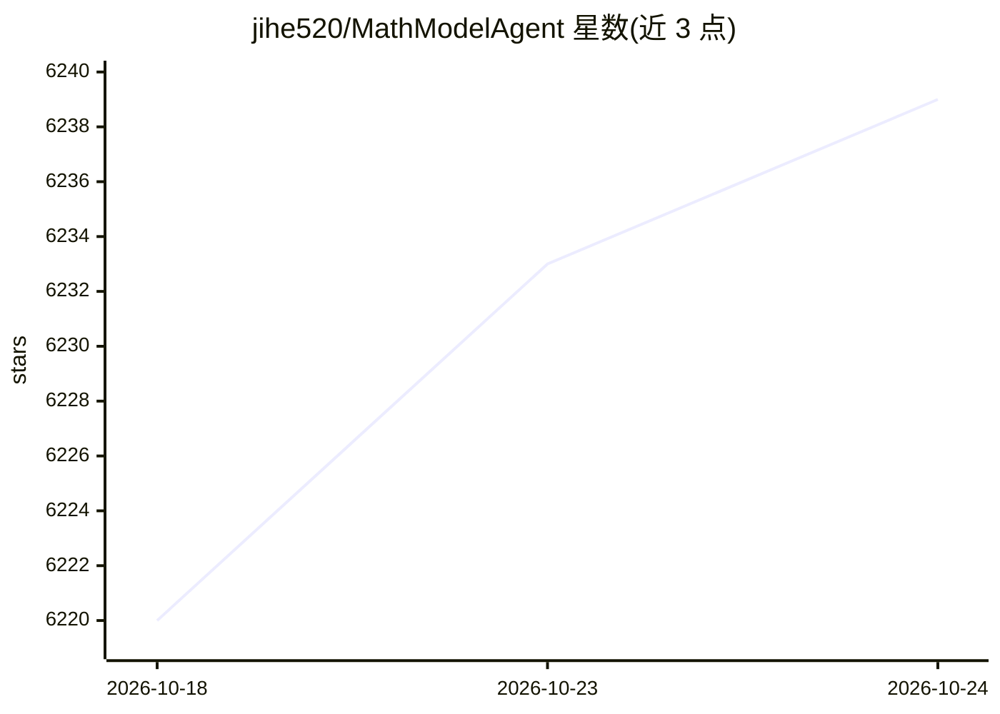

# jihe520/MathModelAgent

⭐ 6,246 · TeX · 推送 2026-10-03 · [GitHub](https://github.com/jihe520/MathModelAgent) · [官网](https://mathmodel.top/home) · 个人维护 · 中文 README

**数学建模 Agent & SKILLS：自动建模并生成可提交论文**

面向数学建模竞赛用户的 Agent 与 SKILL 集合：通过 Claude Code 等 Harness 驱动，以一条 /1start-mathmodel 命令串联问题分析、建模、编码绘图、DrawIO 图示、Typst 排版与 9 步验收，生成可直接提交的 PDF 论文；内置 17 套中英文赛事模板与建模知识库，另提供数模论文转 EI 会议论文的 Skill。提供 macOS/Windows 桌面版（内置 Claude Code），也可用 npx skills add 安装 SKILL，或 Docker/本地（Python+Node.js+Redis）部署 Web 版。README 自述项目处于实验迭代阶段。

## 筛选速览

| 维度 | 判定 | 备注 |
|---|---|---|
| AI 角色 | `ai-native` | 本体是模型或模型工具 |
| 许可风险 | `none` | — |
| 部署形态 | `desktop` | 安装包/桌面程序 |
| 模型依赖 | — | README 未给出锁定关系 |
| 硬件要求 | — | 无带数字的原话,不猜 |
| 安装摩擦 | `low` | 无编译、无系统依赖或容器化 |
| 成熟度 | `idea` | |

## 能力要点

- 一条命令串联 6 阶段（分析→建模→编码→绘图→写作→验收）自动完成数学建模
- 17 套 Typst 中英文赛事论文模板，自动匹配赛事类型
- 9 步自动验收：文本泄漏检测、数值一致性校验、Typst 编译、PDF 可视化检查
- 桌面版内置 Claude Code 与全套 SKILLS，填 API Key 即可使用

## 适用场景

- 数学建模竞赛中自动完成建模并生成可提交的论文
- 已有数模论文改写为英文 EI 会议论文
- 按需单独调用某阶段 Skill（如只做分析或只写论文）

## 场景标签

`AI 写作` · 领域:内容生成

## 证据(README 行号)

> L3:  专为数学建模设计的 Agent
> L76: **🧠 端到端自动化**
> L97: |1start-mathmodel|启动完整数学建模流程，安排各阶段任务|建模计划与任务清单|

## 星数曲线

2026-10-18 6,220 → 2026-10-24 6,239（+19）

---
*卡片 v1 · prompt 1.4 · 生成 2026-10-20 · 置信度 high · 依据 README sha `6a1fdae2a01c` · [字段定义](../../DATASET.md)*
