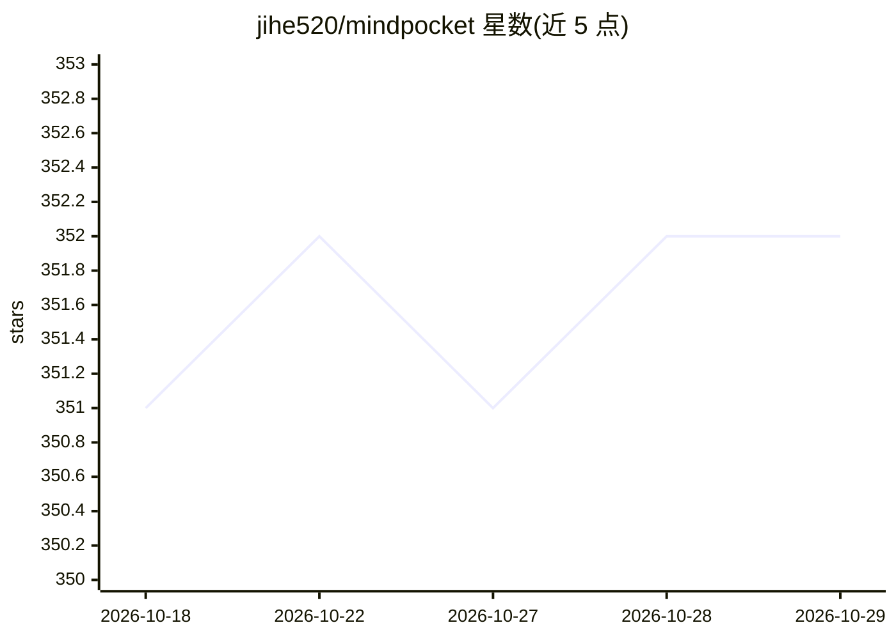

# jihe520/mindpocket

⭐ 352 · TypeScript · 推送 2026-07-28 · [GitHub](https://github.com/jihe520/mindpocket) · [官网](https://mindpocket.top) · 个人维护 · 中文 README

**开源多端个人收藏夹系统，集成 RAG 与 AI Agent**

个人书签收藏系统，提供 Web、移动端（iOS/Android）与浏览器扩展三端使用。部署于 Cloudflare 免费层（Workers + D1 + Vectorize + R2），单个 Worker 同时服务静态前端与 API。功能包括 RAG 内容摘要与自动标签生成，以及面向外部 agent 的官方 CLI 与 agent skill。技术栈为 Next.js 16、Hono、Drizzle ORM、Expo 等。作者自述为 VIBE CODING 项目，核心功能由本人实现、其余由 Claude Code 生成（26,256 行代码）。

## 筛选速览

| 维度 | 判定 | 备注 |
|---|---|---|
| AI 角色 | `ai-enhanced` | 去掉 AI 部分产品仍成立 |
| 许可风险 | `none` | — |
| 部署形态 | `library` | 以包/库形式分发 |
| 模型依赖 | — | README 未给出锁定关系 |
| 硬件要求 | — | 无带数字的原话,不猜 |
| 安装摩擦 | `low` | 无编译、无系统依赖或容器化 |
| 成熟度 | — | 结构信号不足 |

## 能力要点

- RAG 内容摘要与自动标签生成
- 单命令部署至 Cloudflare 免费层，无需维护服务器
- 官方 CLI 与 agent skill 供外部 agent（如 OpenClaw）集成
- Web + 移动端 + 浏览器扩展三端支持

## 适用场景

- 跨设备保存和管理网页收藏
- 通过 AI 摘要与自动标签快速检索收藏内容
- 让外部 agent 通过 CLI 操作书签工作流

## 场景标签

`知识库管理` · 领域:知识与检索

## 证据(README 行号)

> L18: MindPocket organizes your bookmarks with AI-powered RAG content summarization and automatic tag generation, making 
> L25: 4. **AI Enhanced**: RAG and AI Agent for smart tagging and summarization

## 星数曲线

2026-10-18 351 → 2026-10-29 352（+1）

---
*卡片 v1 · prompt 1.4 · 生成 2026-10-21 · 置信度 high · 依据 README sha `b0bb53808805` · [字段定义](../../DATASET.md)*
