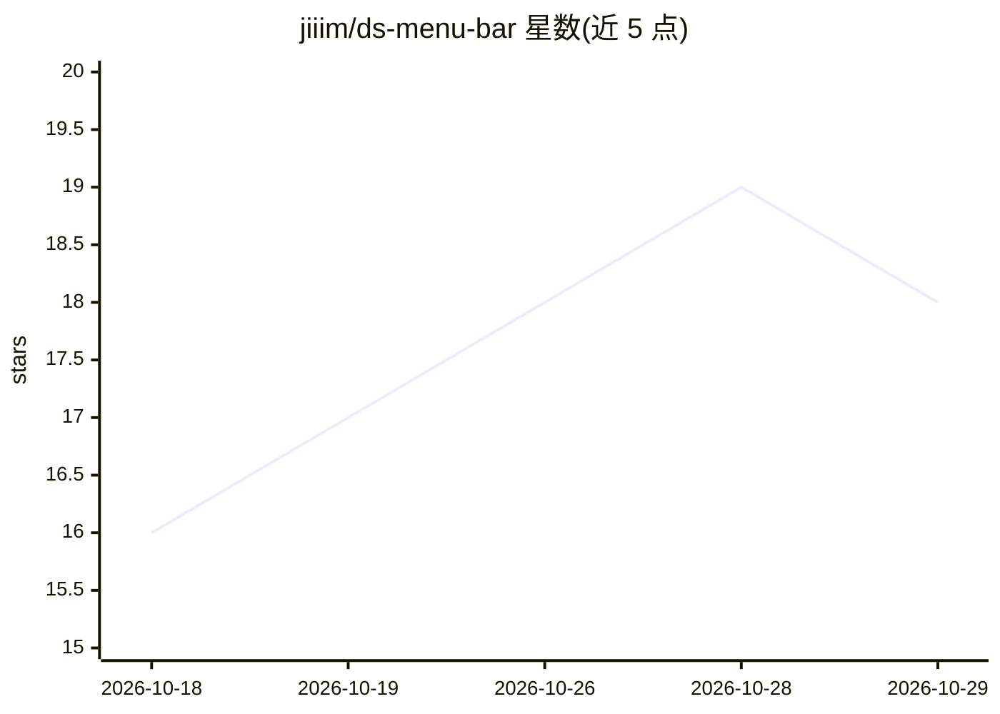

# jiiim/ds-menu-bar

⭐ 18 · Swift · MIT · 推送 2026-10-27 · [GitHub](https://github.com/jiiim/ds-menu-bar) · 个人维护

**macOS 菜单栏控制工具：启停并监控本地 ds4-server 进程**

面向已自建 DwarfStar 环境的用户，在 Mac 菜单栏中启动、停止、配置与监控单个本地 ds4-server 进程，无需保持终端窗口。用户自选可执行文件与 GGUF 模型，应用展示完整启动命令、进程状态、prefill/生成吞吐，并提供性能、KV cache、MTP 投机解码、日志与请求追踪等七面板设置。仅管理本机进程，不下载或构建服务器与模型，不管理远程/Linux/CUDA/ROCm 服务器；兼容性跟踪上游特定 commit，仅识别指定 DwarfStar GGUF 家族。

## 筛选速览

| 维度 | 判定 | 备注 |
|---|---|---|
| AI 角色 | `ai-ecosystem` | LLM/agent 周边工具 |
| 许可风险 | `permissive` | MIT |
| 部署形态 | `desktop` | 安装包/桌面程序 |
| 模型依赖 | — | README 未给出锁定关系 |
| 硬件要求 | — | 无带数字的原话,不猜 |
| 安装摩擦 | `high` | 编译与系统依赖俱全 |
| 成熟度 | — | 结构信号不足 |

## 能力要点

- 菜单栏启停监控单个 ds4-server，显示状态、PID 与 prefill/生成吞吐
- 七面板设置：性能（上下文/GPU 功率/SSD 流式加载）、KV cache 磁盘检查点、MTP 投机解码等
- 应用前可查看完整生成的启动命令，配置改动即时重启生效
- 崩溃/无响应自动重启一次、日志轮转、可选请求追踪

## 适用场景

- 在 Mac 上不开终端即可管理本地 ds4-server 的启停与配置
- 运行本地 OpenAI/Anthropic/Responses 兼容端点供任意客户端调用
- 对上下文、KV cache、投机解码等服务器参数做模型感知调优

## 场景标签

 · 领域:本地 LLM 服务器管理/桌面工具

## 证据(README 行号)

> L6: DwarfStar setup. It starts, stops,
> L37: - Starts, stops, and monitors `ds4-server` from
> L28: - Use the resulting local endpoint with any client that speaks one of the

## 星数曲线

2026-10-18 16 → 2026-10-29 18（+2）

---
*卡片 v1 · prompt 1.4 · 生成 2026-10-29 · 置信度 high · 依据 README sha `7c6bedbadd4d` · [字段定义](../../DATASET.md)*
