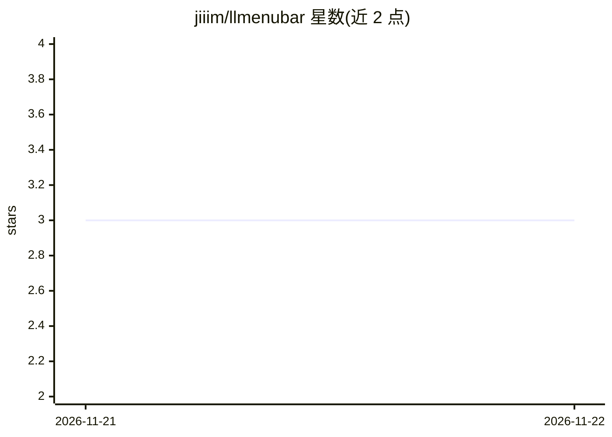

# jiiim/llmenubar

⭐ 3 · Swift · MIT · 推送 2026-11-18 · [GitHub](https://github.com/jiiim/llmenubar) · [官网](https://llmenubar.app/) · 个人维护

**macOS 菜单栏应用，管理本地推理引擎的启停与配置**

LLMenuBar 是原生 macOS 菜单栏应用，用于启动、停止和配置用户另行安装的本地推理引擎（当前支持 Splash 引擎，运行 `splash serve`）。它不内置聊天窗口、终端或日志查看器，浏览器聊天页面可一键打开；提供全部 splash serve 选项的图形化设置、生成速度常显、OpenAI/Anthropic 端点与 API key 一键复制、密钥存入 macOS Keychain。需要 macOS 26 与 Apple silicon Mac，引擎需单独安装。

## 筛选速览

| 维度 | 判定 | 备注 |
|---|---|---|
| AI 角色 | `ai-ecosystem` | LLM/agent 周边工具 |
| 许可风险 | `permissive` | MIT |
| 部署形态 | `desktop` | 安装包/桌面程序 |
| 模型依赖 | — | README 未给出锁定关系 |
| 硬件要求 | — | 无带数字的原话,不猜 |
| 安装摩擦 | `medium` | 含编译或系统依赖之一 |
| 成熟度 | — | 结构信号不足 |

## 能力要点

- 菜单栏常驻管理 `splash serve`，启动/停止/改配置一步应用
- 开放全部 splash serve 选项：draft model、vision projector、离线模式等
- API key 与 Hugging Face token 存入 macOS Keychain
- 内存占用低于 Splash 桌面应用（65 MB vs 358 MB 峰值）

## 适用场景

- 在菜单栏管理本地模型服务，避免 Dock 图标干扰
- 把本地引擎端点快速复制到浏览器聊天或其他客户端
- 为私有或 gated 的 Hugging Face 模型配置访问 token

## 场景标签

 · 领域:LLM 基础设施/本地推理管理

## 证据(README 行号)

> L7: LLMenuBar is a lightweight, native macOS menu bar app that starts, stops, and configures a local inference engine th
> L34: - Splash, installed or built separately: the Splash desktop app, the `splash` command installed with `brew install 

## 星数曲线

2026-11-21 3 → 2026-11-22 3（+0）

---
*卡片 v1 · prompt 1.4 · 生成 2026-11-21 · 置信度 high · 依据 README sha `87e6cab1fc3c` · [字段定义](../../DATASET.md)*
