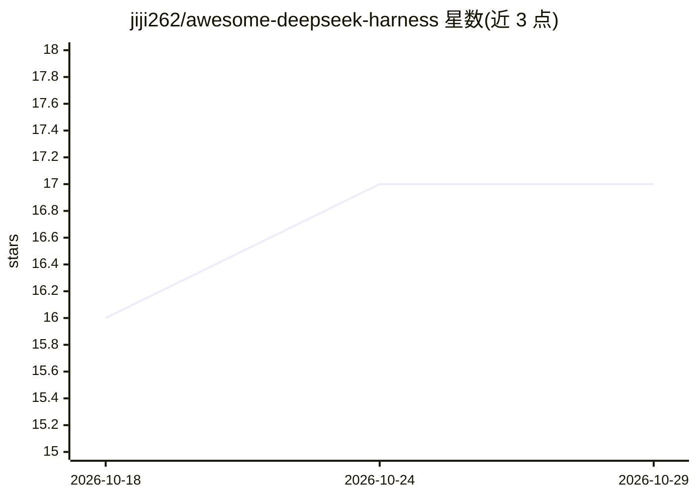

# jiji262/awesome-deepseek-harness

⭐ 17 · 推送 2026-08-19 · [GitHub](https://github.com/jiji262/awesome-deepseek-harness) · 个人维护 · 中文 README

**DeepSeek Harness 生态精选清单：插件、客户端、教程聚合**

中英双语 awesome list，围绕 DeepSeek 于 2026 年 8 月开源的 Agent Harness（DSH）策展生态资源：官方仓库与文档、插件市场、约 18 个桌面客户端、Web UI 增强与皮肤、功能扩展插件、Agent Skills、记忆与上下文项目、同类 harness 运行时、周边工具与约 9 个教程项目，每条附 star 数（2026-08-19 快照）与简介。面向想在 DSH 生态中发现插件与学习资源的开发者和用户，接受 PR 贡献。本仓库为清单本身，不提供可直接运行的产品功能。

## 筛选速览

| 维度 | 判定 | 备注 |
|---|---|---|
| AI 角色 | `ai-knowledge` | 知识聚合/清单类 |
| 许可风险 | `none` | — |
| 部署形态 | `library` | 以包/库形式分发 |
| 模型依赖 | — | README 未给出锁定关系 |
| 硬件要求 | — | 无带数字的原话,不猜 |
| 安装摩擦 | `low` | 无编译、无系统依赖或容器化 |
| 成熟度 | — | 结构信号不足 |

## 能力要点

- 覆盖插件市场、桌面客户端、功能插件、Skills、记忆系统、教程等 10+ 类 DSH 生态资源
- 中英双语条目，附 star 快照与简评
- 收录多个插件发现与实测验证类项目（如容器内真实安装实测的插件雷达）

## 适用场景

- 为 DSH 挑选桌面客户端或 TUI 界面
- 查找视觉、多智能体、记忆、权限管理等方向的 DSH 插件
- 通过收录的教程从零学习 harness 工程与插件开发

## 场景标签

`精选清单` · 领域:学习与行业

## 证据(README 行号)

> L5: > 精选 DeepSeek Harness (DSH) 相关的开源项目、插件、桌面客户端、插件市场与教程。
> L29: - awesome-dsh-plugin/awesome-dsh-plugin ⭐ 9.7k - DSH 插件精选列表（中英双语），目前社区最大的插件清单。

## 星数曲线

2026-10-18 16 → 2026-10-29 17（+1）

---
*卡片 v1 · prompt 1.4 · 生成 2026-10-29 · 置信度 mid · 依据 README sha `1a5e4bd05169` · [字段定义](../../DATASET.md)*
