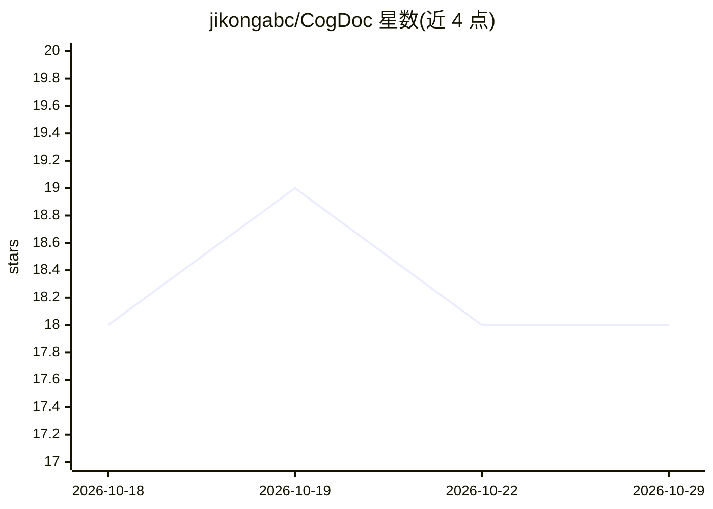

# jikongabc/CogDoc

⭐ 18 · Python · MIT · 推送 2026-08-31 · [GitHub](https://github.com/jikongabc/CogDoc) · 个人维护 · 中文 README

**本地优先的 AI 知识与研究工作台：多源 RAG 与可验证引用**

面向个人与团队的本地 RAG 知识库工作台，基于 LangGraph 多 agent 编排与 Rust（PyO3+maturin）加速核心。支持对 PDF/Markdown/HTML/Office/表格/图片做问答、结构化摘要与多文档对比，每个生成声明绑定版本化来源位置，由 Rust 校验器核查并自愈重生成。提供 Web 工作台（Next.js）、CLI、Streamlit 兼容客户端与 Debug 控制台。检索为向量+BM25 混合并做 RRF 融合，中文分词用 jieba-rs。含派生知识审核闭环、反馈调优、OIDC/SCIM 企业认证与检索 ACL。安装需 pip 安装并 make native 编译 Rust 扩展，Web 需 Node.js 22+，需配置 LLM API key 或 Ollama。

## 筛选速览

| 维度 | 判定 | 备注 |
|---|---|---|
| AI 角色 | `ai-native` | 本体是模型或模型工具 |
| 许可风险 | `permissive` | MIT |
| 部署形态 | `library` | 以包/库形式分发 |
| 模型依赖 | local-ok | 支持本地模型 |
| 硬件要求 | — | 无带数字的原话,不猜 |
| 安装摩擦 | `low` | 无编译、无系统依赖或容器化 |
| 成熟度 | — | 结构信号不足 |

## 能力要点

- 生成声明绑定版本化来源位置，Rust 校验器捕获伪造引用并自愈重生成
- 向量+BM25 混合检索，查询级 RRF 确定性融合，中文 jieba-rs 分词
- 多知识库/多会话/分层记忆，错误答案不进入 agent 记忆
- 派生知识审核闭环与证据级检索评测飞轮，企业 OIDC/SCIM 与检索前 ACL

## 适用场景

- 把 PDF、Markdown、Office 等资料建成本地知识库做带引用的问答
- 对多篇文档做多维度对比与结构化摘要
- 团队场景下管理知识库权限并审核派生知识

## 场景标签

`RAG` `文档问答` `知识库管理` · 领域:知识与检索

## 证据(README 行号)

> L7: A local RAG knowledge-base console for individuals and teams, built on **LangGraph multi-agent orchestration** with 
> L23: - **Hybrid retrieval, query-level fusion** — each original, rewritten, and requirement-specific query searches the 

## 星数曲线

2026-10-18 18 → 2026-10-29 18（+0）

---
*卡片 v1 · prompt 1.4 · 生成 2026-10-29 · 置信度 high · 依据 README sha `729b3d80853d` · [字段定义](../../DATASET.md)*
