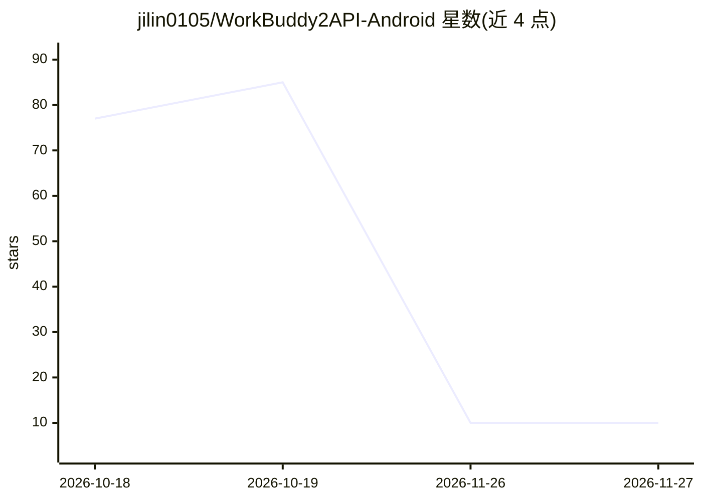

# jilin0105/WorkBuddy2API-Android

⭐ 10 · Kotlin · MIT · 推送 2026-11-17 · [GitHub](https://github.com/jilin0105/WorkBuddy2API-Android) · 个人维护 · 中文 README

**把 WorkBuddy 额度封装成手机本地 OpenAI/Anthropic 兼容 API 的 Android 网关**

运行在 Android 手机上的本地 API 网关：将腾讯 WorkBuddy / CodeBuddy 的模型额度转换为标准 OpenAI / Anthropic 协议接口，供局域网内的电脑、客户端（Claude Code、Cherry Studio、Codex CLI）直接调用。Kotlin 原生实现，APK 约 1.7 MB，HTTP 服务用 java.net.ServerSocket 手写，SQLite 存储账号与用量，AES-GCM 加密 API Key。内置多账号加权轮换、每日自动签到、用量统计，以及前台服务/WakeLock/悬浮球等多层保活机制应对国产 ROM 后台限制。仅供学习用途，README 明确禁止商用与违反上游服务条款。

## 筛选速览

| 维度 | 判定 | 备注 |
|---|---|---|
| AI 角色 | `ai-ecosystem` | LLM/agent 周边工具 |
| 许可风险 | `permissive` | MIT |
| 部署形态 | `None` |  |
| 模型依赖 | — | README 未给出锁定关系 |
| 硬件要求 | — | 无带数字的原话,不猜 |
| 安装摩擦 | `medium` | 含编译或系统依赖之一 |
| 成熟度 | — | 结构信号不足 |

## 能力要点

- 三协议兼容：OpenAI Chat/Responses 与 Anthropic Messages，均支持流式与非流式
- 多账号加权随机轮换、失败冷却与自动重试，支持每日定时签到领额度
- SQLite 用量记录与筛选统计，API Key 采用 AES-GCM 加密存储
- 前台服务+WakeLock+开机自启+悬浮球等多层 Android 保活方案

## 适用场景

- 在 Claude Code / Cherry Studio 里用手机上的 WorkBuddy 额度做模型后端
- 多账号额度统一管理并按余额/成功率自动轮换
- 局域网内给其他应用提供 OpenAI 格式的本地接口

## 场景标签

`模型网关` · 领域:Agent 开发

## 证据(README 行号)

> L24: 一个跑在 Android 手机上的本地 API 网关。启动后，你的电脑、平板或其它 App 可以通过局域网连到手机上的 API 端口，
> L36: - 🔌 **三协议兼容** — OpenAI Chat (`/v1/chat/completions`)、Anthropic Messages (`/v1/messages`)、OpenAI Responses (`/v1/res

## 星数曲线

2026-10-18 77 → 2026-11-27 10（-67）

---
*卡片 v1 · prompt 1.4 · 生成 2026-11-26 · 置信度 mid · 依据 README sha `b04801296b4a` · [字段定义](../../DATASET.md)*
