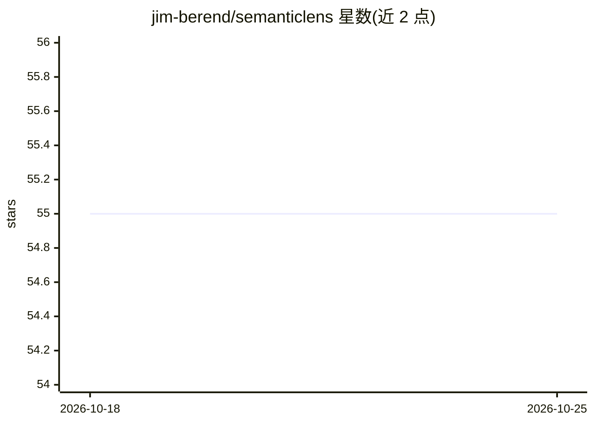

# jim-berend/semanticlens

⭐ 55 · Python · BSD-3-Clause · 推送 2026-08-23 · [GitHub](https://github.com/jim-berend/semanticlens) · [官网](https://jim-berend.github.io/semanticlens/) · 个人维护

**解读与验证大型视觉模型的 PyTorch 语义解释框架**

开源 PyTorch 库，面向需要解释和验证大型视觉模型的研究者与开发者。核心机制分三步：用 ComponentVisualizers 收集使各组件（神经元/滤波器）激活最高的样本；将样本送入 CLIP/SigLIP 等基础模型生成语义向量嵌入（内置支持 OpenCLIP）；通过 Lens 类编排预处理、缓存与评估，支持对模型内部表示的搜索、分析与审计。以 pip 包提供，含快速入门 notebook 与文档，BSD 3-Clause 许可，配套论文发表于 Nature Machine Intelligence。

## 筛选速览

| 维度 | 判定 | 备注 |
|---|---|---|
| AI 角色 | `ai-ecosystem` | LLM/agent 周边工具 |
| 许可风险 | `permissive` | BSD-3-Clause |
| 部署形态 | `library` | 以包/库形式分发 |
| 模型依赖 | — | README 未给出锁定关系 |
| 硬件要求 | — | 无带数字的原话,不猜 |
| 安装摩擦 | `low` | 无编译、无系统依赖或容器化 |
| 成熟度 | — | 结构信号不足 |

## 能力要点

- 将模型内部组件映射到 CLIP/SigLIP 语义空间
- 多种 ComponentVisualizers 策略（激活最大化、相关性最大化、归因裁剪）
- Lens 类统一接口支持搜索与审计模型内部表示
- 内置 OpenCLIP 支持，可扩展其他基础模型

## 适用场景

- 分析和解释视觉模型内部神经元的功能
- 审计与验证大模型内部表示
- 按语义概念搜索模型组件

## 场景标签

`模型评测` · 领域:评测与运维

## 证据(README 行号)

> L3:  An open-source PyTorch library for interpreting and validating large vision models.
> L22: **SemanticLens** is a universal framework for explaining and validating large vision models. While deep learning mo
> L33: 1) **Collect**: For each component in a model M, we identify the data samples that cause the highest activation (th

## 星数曲线

2026-10-18 55 → 2026-10-25 55（+0）

---
*卡片 v1 · prompt 1.4 · 生成 2026-10-24 · 置信度 high · 依据 README sha `329d6a048e28` · [字段定义](../../DATASET.md)*
