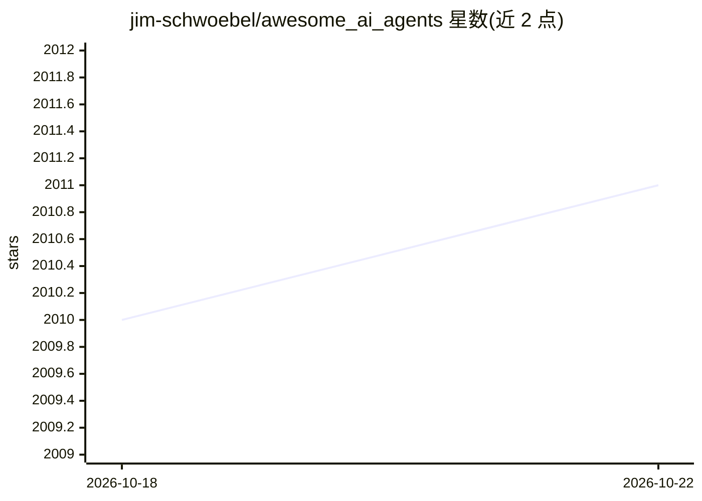

# jim-schwoebel/awesome_ai_agents

⭐ 2,011 · Apache-2.0 · 推送 2026-03-28 · [GitHub](https://github.com/jim-schwoebel/awesome_ai_agents) · [官网](https://agents.blog) · 个人维护

**AI agent 工具与资源策展清单（1,500+ 条）**

由个人维护的 AI agent 主题 awesome 清单，收录 1,500+ 条工具、框架、数据集、LLM 模型与课程等资源，声称每日更新。主体按应用类别组织（40 余类，如编码代理、客服、数据科学、桌面代理、模型服务等），每类下罗列项目及其简介与链接；另含学习路径（入门/进阶/多智能体系统）与学习仓库列表。README 同时宣传一场线上会议。作为清单本身不提供安装或运行方式，仅可浏览与贡献条目。

## 筛选速览

| 维度 | 判定 | 备注 |
|---|---|---|
| AI 角色 | `ai-knowledge` | 知识聚合/清单类 |
| 许可风险 | `permissive` | Apache-2.0 |
| 部署形态 | `library` | 以包/库形式分发 |
| 模型依赖 | — | README 未给出锁定关系 |
| 硬件要求 | — | 无带数字的原话,不猜 |
| 安装摩擦 | `low` | 无编译、无系统依赖或容器化 |
| 成熟度 | — | 结构信号不足 |

## 能力要点

- 收录 1,500+ 条 AI agent 相关工具、框架、数据集与项目
- 按 40 余个应用类别组织（编码、客服、桌面代理、模型服务等）
- 包含面向初学者到进阶者的学习路径与推荐仓库
- 接受社区贡献并声称每日更新

## 适用场景

- 按类别查找可用的 AI agent 工具与框架
- 了解 AI agent 生态中有哪些项目与数据集
- 入门学习 AI agent 开发的路径与资源

## 场景标签

`精选清单` `教程课程` · 领域:学习与行业

## 证据(README 行号)

> L11: This repository is a comprehensive hub for resources related to AI agents, providing a curated collection of tools,
> L71: ### Applications

## 星数曲线

2026-10-18 2,010 → 2026-10-22 2,011（+1）

---
*卡片 v1 · prompt 1.4 · 生成 2026-10-21 · 置信度 mid · 依据 README sha `63f62ac84c2e` · [字段定义](../../DATASET.md)*
