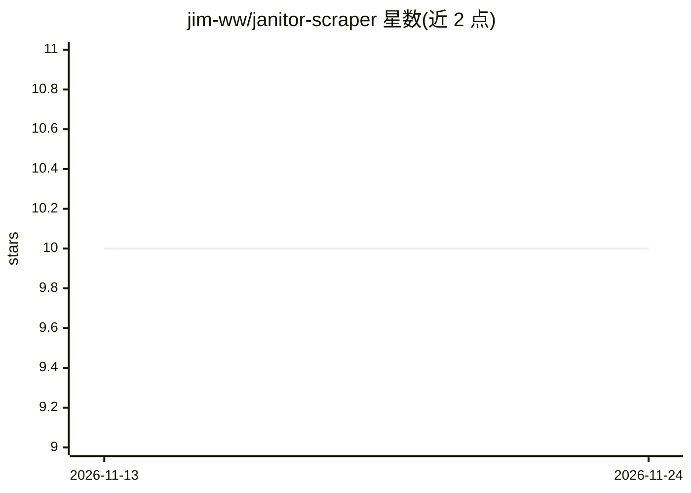

# jim-ww/janitor-scraper

⭐ 10 · Go · GPL-3.0 · 推送 2026-07-19 · [GitHub](https://github.com/jim-ww/janitor-scraper) · 个人维护

**抓取 Janitor AI 角色描述与聊天记录的代理工具**

以本地代理形式运行的工具：用户在 Janitor AI 的 API 设置中把该工具配置为 OpenAI 兼容代理（localhost:8080 + /v1/chat/completions），随后聊天时工具在终端输出角色完整描述与全部消息，格式干净可读。提供 GitHub Release 二进制直接下载，Mac/Linux 运行可执行文件即可，支持 -address 修改监听地址，可通过 ngrok 提供公网 URL 以便 Janitor AI 访问本机。以 GPLv3 许可发布。

## 筛选速览

| 维度 | 判定 | 备注 |
|---|---|---|
| AI 角色 | `ai-enhanced` | 去掉 AI 部分产品仍成立 |
| 许可风险 | `viral` | GPL-3.0 |
| 部署形态 | `None` |  |
| 模型依赖 | — | README 未给出锁定关系 |
| 硬件要求 | — | 无带数字的原话,不猜 |
| 安装摩擦 | `low` | 无编译、无系统依赖或容器化 |
| 成熟度 | — | 结构信号不足 |

## 能力要点

- 以 OpenAI 兼容代理端点方式接入 Janitor AI（/v1/chat/completions）
- 下载 Release 二进制后直接运行，无需安装依赖
- 支持 -address 自定义监听地址与 ngrok 公网代理
- 终端输出角色描述与消息的可读格式

## 适用场景

- 以可读格式保存与 Janitor AI 角色的聊天记录
- 提取角色的完整描述文本

## 场景标签

`网页抓取` · 领域:效率与自动化

## 证据(README 行号)

> L3: A simple tool that fetches character descriptions and messages from Janitor AI in a clean, readable format.
> L24: 1. In Janitor AI, go to API Settings → Proxy
> L28: 5. Proxy URL: paste `localhost:8080` (or whatever address the tool is listening on) + /v1/chat/completions

## 星数曲线

2026-11-13 10 → 2026-11-24 10（+0）

---
*卡片 v1 · prompt 1.4 · 生成 2026-11-19 · 置信度 high · 依据 README sha `648608e8be9b` · [字段定义](../../DATASET.md)*
