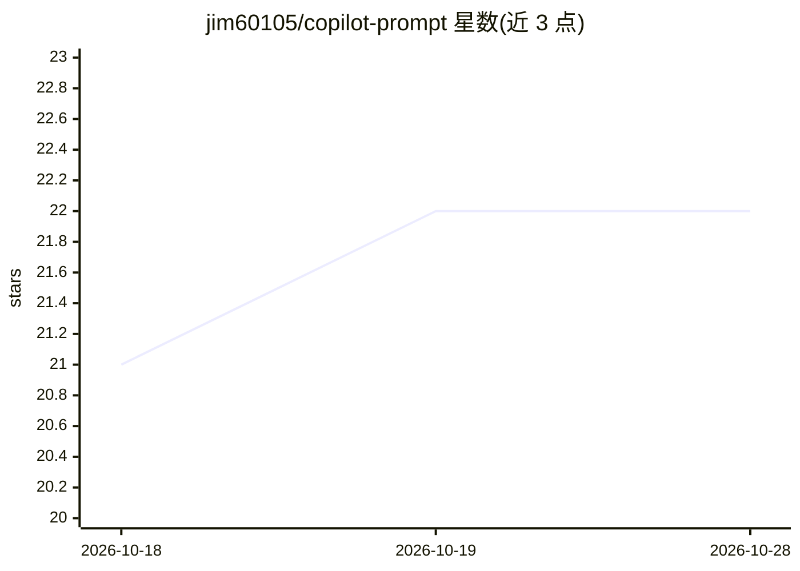

# jim60105/copilot-prompt

⭐ 22 · Python · GFDL-1.3 · 推送 2026-10-16 · [GitHub](https://github.com/jim60105/copilot-prompt) · 个人维护 · 中文 README

**个人 GitHub Copilot 提示词与指令配置仓库**

存放作者个人 AI 编程工具提示词的配置仓库，内容为 SKILL.md/instructions 格式的提示词文件，供复制粘贴使用。定位是个人 dotfiles 的一部分：以 submodule 形式纳入 jim60105/dotfiles，用 chezmoi 跨系统管理，并通过 VSCode 的 chat.instructionsFilesLocations 设置指向仓库内的 instructions 目录。README 明确提示这是个人配置，建议先 fork 再修改并替换其中的个人域名与用户名。许可证为 GFDL v1.3。

## 筛选速览

| 维度 | 判定 | 备注 |
|---|---|---|
| AI 角色 | `ai-ecosystem` | LLM/agent 周边工具 |
| 许可风险 | `viral` | GFDL-1.3 |
| 部署形态 | `None` |  |
| 模型依赖 | — | README 未给出锁定关系 |
| 硬件要求 | — | 无带数字的原话,不猜 |
| 安装摩擦 | `low` | 无编译、无系统依赖或容器化 |
| 成熟度 | — | 结构信号不足 |

## 能力要点

- SKILL.md/instructions 格式的个人提示词集合
- 通过 chezmoi 与 dotfiles submodule 跨系统管理
- 配套 VSCode chat.instructionsFilesLocations 配置说明

## 适用场景

- 作为个人 Copilot 提示词的跨设备同步存储
- fork 后改造成自己的 AI 编程助手指令集
- 参考他人 Copilot 配置与提示词写法

## 场景标签

`提示工程` · 领域:Agent 开发

## 证据(README 行号)

> L3: This is my GitHub Copilot prompt repository, used to store my personal prompts for easy copy and paste.
> L17:     "chat.instructionsFilesLocations": {

## 星数曲线

2026-10-18 21 → 2026-10-28 22（+1）

---
*卡片 v1 · prompt 1.4 · 生成 2026-10-28 · 置信度 high · 依据 README sha `005ff7afc10a` · [字段定义](../../DATASET.md)*
