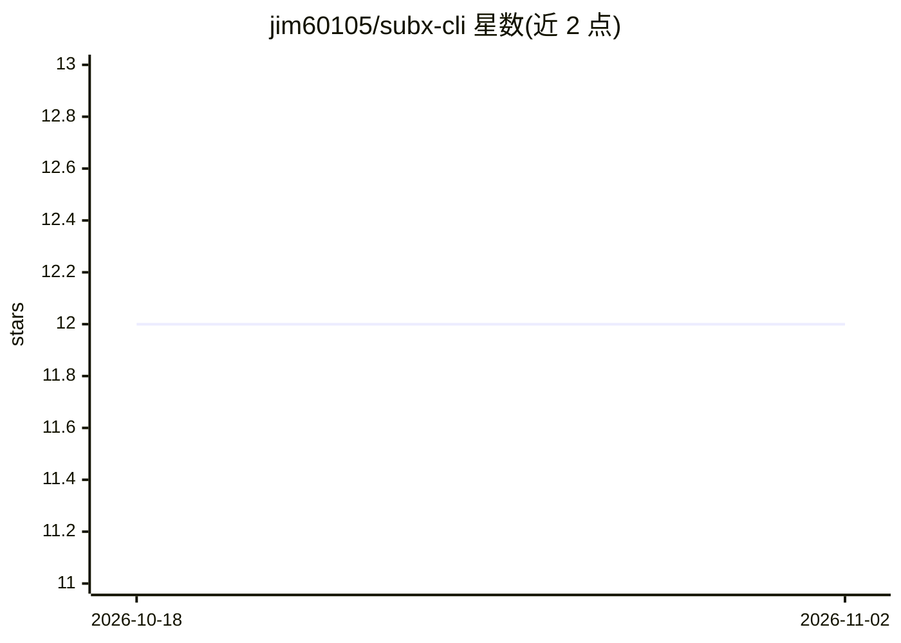

# jim60105/subx-cli

⭐ 12 · Rust · GPL-3.0 · 推送 2026-09-07 · [GitHub](https://github.com/jim60105/subx-cli) · 个人维护 · 中文 README

**AI 字幕工具 CLI：自动匹配、改名、格式转换与时间轴校正**

用 Rust 编写的字幕处理命令行工具：指向媒体文件夹后用 AI 判断字幕文件与视频的对应关系（文件名可跨语言、无共同命名规律），并支持 SRT/ASS/VTT/SUB 间的格式转换、基于本地 VAD 的时间轴校正、字符编码检测，以及调用配置的 AI 提供商翻译字幕文本。AI 后端可选 OpenAI、Azure OpenAI 或任意 OpenAI 兼容本地运行时（Ollama、LM Studio、llama.cpp、vLLM）。提供单行安装脚本与预编译二进制（Linux/macOS/Windows，musl 需自行编译），处理引擎以独立 crate subx-core 形式可作库使用，JSON 输出模式面向脚本与 CI。GPLv3 许可。

## 筛选速览

| 维度 | 判定 | 备注 |
|---|---|---|
| AI 角色 | `ai-native` | 本体是模型或模型工具 |
| 许可风险 | `viral` | GPL-3.0 |
| 部署形态 | `desktop` | 安装包/桌面程序 |
| 模型依赖 | local-ok | 支持本地模型 |
| 硬件要求 | — | 无带数字的原话,不猜 |
| 安装摩擦 | `low` | 无编译、无系统依赖或容器化 |
| 成熟度 | — | 结构信号不足 |

## 能力要点

- AI 匹配字幕与视频并支持改名/复制/移动
- 本地 VAD 时间轴校正与 SRT/ASS/VTT/SUB 格式转换
- 支持 OpenAI 兼容本地运行时（Ollama/LM Studio/llama.cpp/vLLM）作为 AI 后端
- 处理引擎 subx-core 独立发布为 Rust 库，CLI 提供 --output json 脚本化输出

## 适用场景

- 批量整理文件命名混乱的字幕与视频文件
- 在不同格式间转换字幕并校正时间轴偏移
- 用本地 LLM 离线翻译字幕而不外发内容

## 场景标签

 · 领域:媒体/字幕工具

## 证据(README 行号)

> L9: AI-powered CLI for automated subtitle matching, renaming, format conversion, and timeline correction.
> L13: Point SubX at a media folder and it uses AI to figure out which subtitle
> L25: SUB), corrects timing drift using local Voice Activity Detection, detects

## 星数曲线

2026-10-18 12 → 2026-11-02 12（+0）

---
*卡片 v1 · prompt 1.4 · 生成 2026-11-01 · 置信度 high · 依据 README sha `68c5b7fa23fd` · [字段定义](../../DATASET.md)*
