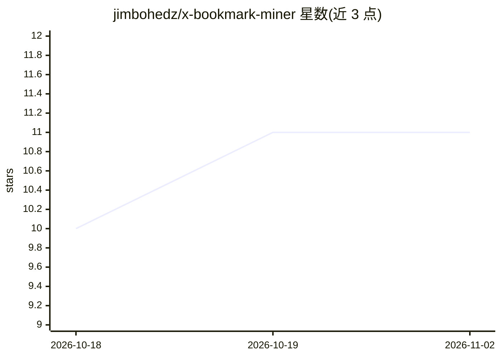

# jimbohedz/x-bookmark-miner

⭐ 11 · Python · MIT · 推送 2026-08-29 · [GitHub](https://github.com/jimbohedz/x-bookmark-miner) · 个人维护

**把 X/Twitter 书签抓取为可搜索 Markdown 知识库的本地工具**

基于 Python 的 X 书签抓取脚本：通过用户本地导出的 cookies 调用自修复 GraphQL 抓取全部书签，输出结构化 Markdown 与分类 JSON，可抓取作者串推、原文文章（t.co 展开→trafilatura→HTML→Playwright 四层提取）、本地图片存档，并用 yt-dlp + faster-whisper 转录视频（GPU 可用则用，回退 CPU）。AI 部分为可选：Gemini 分类（无 key 时关键词回退）、Ollama 语义搜索与视觉模型图像分析，另有面向 Claude Code/Codex 的零 key agent 模式（--raw 输出未分类文件由用户 agent 处理）。支持增量续跑与一键每日定时任务。

## 筛选速览

| 维度 | 判定 | 备注 |
|---|---|---|
| AI 角色 | `ai-enhanced` | 去掉 AI 部分产品仍成立 |
| 许可风险 | `permissive` | MIT |
| 部署形态 | `desktop` | 安装包/桌面程序 |
| 模型依赖 | local-ok | 支持本地模型 |
| 硬件要求 | — | 无带数字的原话,不猜 |
| 安装摩擦 | `low` | 无编译、无系统依赖或容器化 |
| 成熟度 | — | 结构信号不足 |

## 能力要点

- 自修复 GraphQL：从 JS 包自动发现 X 轮换的 query ID
- 四层文章正文提取（t.co→trafilatura→HTML→Playwright）
- faster-whisper 视频转录，GPU 可用则用、CPU 回退
- --raw agent 模式：零 API key，由用户自己的 Claude Code/Codex 生成个性化摘要

## 适用场景

- 把多年积累的 X 书签导出成可搜索的本地知识库
- 配合 Claude Code/Codex 生成贴合个人项目的书签摘要
- 定时每日自动抓取新书签并更新知识库
- 离线语义搜索与按自定义关键词分类管理书签

## 场景标签

`网页抓取` `知识库管理` `语义搜索` `语音识别` · 领域:效率与自动化

## 证据(README 行号)

> L7: Scrape every tweet you've ever bookmarked on X (Twitter) into a structured, searchable Markdown knowledge base and c
> L278: The tool works without any AI key. Keyword-based categorization handles most collections well.
> L102: |**AI categorization (optional)**|Gemini for smart categorization, keyword fallback if no API key|

## 星数曲线

2026-10-18 10 → 2026-11-02 11（+1）

---
*卡片 v1 · prompt 1.4 · 生成 2026-11-02 · 置信度 high · 依据 README sha `b00642d85fd2` · [字段定义](../../DATASET.md)*
