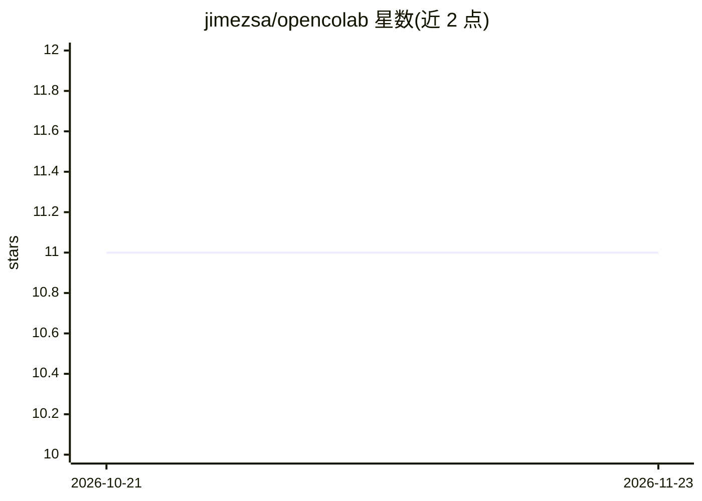

# jimezsa/opencolab

⭐ 11 · TypeScript · MIT · 推送 2026-10-22 · [GitHub](https://github.com/jimezsa/opencolab) · [官网](https://opencolab.ai/) · 个人维护

**科研工作者的常驻自主实验室 agent 编排 CLI**

OpenColab 是一个以 CLI 和 Telegram 为控制面的科研 agent 编排工具：把研究组织为多项目、多 agent 的本地工作区，通过网关路由到上游运行时 CLI（Codex、Claude Code、Gemini CLI、PI），驱动深度研究技能群（论文检索、RAG 问答、图表抽取、并行摘要、LaTeX 论文生成），并经 Runpod 在远程 GPU 上运行实验。npm 包发布，MIT 许可，README 自述为 Beta 早期阶段。使用前需安装并配置对应 provider 的运行时 CLI 与 API key。

## 筛选速览

| 维度 | 判定 | 备注 |
|---|---|---|
| AI 角色 | `ai-ecosystem` | LLM/agent 周边工具 |
| 许可风险 | `permissive` | MIT |
| 部署形态 | `library` | 以包/库形式分发 |
| 模型依赖 | locked-api |  |
| 硬件要求 | — | 无带数字的原话,不猜 |
| 安装摩擦 | `low` | 无编译、无系统依赖或容器化 |
| 成熟度 | `idea` | |

## 能力要点

- 深度研究技能群：论文检索、RAG 问答、图表抽取、并行摘要、LaTeX 论文生成
- 支持 OpenAI、Anthropic、Gemini、MiniMax、xAI、OpenRouter、Kimi 等 provider 的 API key 或 OAuth 配置
- 每项目一个 Telegram bot，CLI 与 Telegram 双控制面，带网关后台运行
- 经 Runpod 执行远程 GPU 实验，含 SSH profile 与任务状态轮询命令

## 适用场景

- 让 agent 团队围绕研究课题持续执行从假设到证据的调研与实验
- 通过 Telegram 随时与不同项目的 agent 对话并查看运行状态
- 把实验放到 Runpod 远程 GPU 服务器上运行并回收日志指标
- 生成 git 版本化的 LaTeX 论文工作区并构建 PDF

## 场景标签

`多智能体` `RAG` `科研工具` · 领域:Agent 开发

## 证据(README 行号)

> L9: _Accelerating Scientific Discovery_ — Turn your research into an always-on autonomous lab that investigates, builds,
> L13: - ✅ Deep Research swarm skills for paper search, grounded QA (Reasoning-based RAG), figure extraction, parallel sum
> L30: **Note:** OpenColab is an early-stage, actively evolving project. Features and documentation are rapidly improving—

## 星数曲线

2026-10-21 11 → 2026-11-23 11（+0）

---
*卡片 v1 · prompt 1.4 · 生成 2026-11-18 · 置信度 high · 依据 README sha `5eff3700debd` · [字段定义](../../DATASET.md)*
