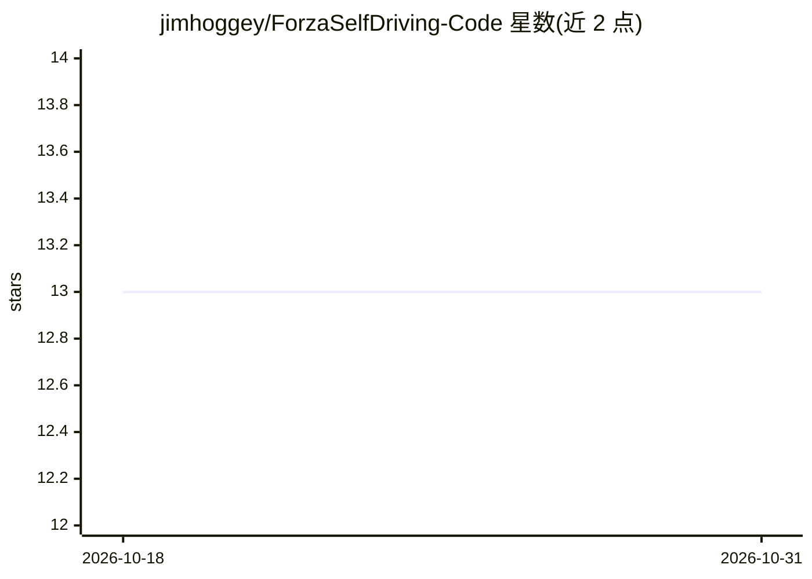

# jimhoggey/ForzaSelfDriving-Code

⭐ 13 · Python · 推送 2026-09-12 · [GitHub](https://github.com/jimhoggey/ForzaSelfDriving-Code) · 个人维护

**在 Forza Horizon 3 录像上做自动驾驶感知实验的个人项目代码**

个人研究项目：以 Forza Horizon 3 游戏作为自动驾驶虚拟测试环境，对预录制的驾驶视频运行视觉算法，提取车道线、其他车辆、行人、交通灯与速度标识等特征，供未来完整自动驾驶模型做决策参考。代码基于 Python、OpenCV、TensorFlow，复用 CarND-Advanced-Lane-Lines 车道线系统与 Sigil-Wen/YOLO 目标检测，使用德国交通标志基准数据集训练。运行方式为执行 installall.sh 安装依赖后在 Jupyter notebook 中运行；不直接控制游戏内车辆，当前阶段为录像离线处理。

## 筛选速览

| 维度 | 判定 | 备注 |
|---|---|---|
| AI 角色 | `ai-native` | 本体是模型或模型工具 |
| 许可风险 | `none` | — |
| 部署形态 | `None` |  |
| 模型依赖 | — | README 未给出锁定关系 |
| 硬件要求 | — | 无带数字的原话,不猜 |
| 安装摩擦 | `low` | 无编译、无系统依赖或容器化 |
| 成熟度 | — | 结构信号不足 |

## 能力要点

- 从预录制游戏驾驶视频中提取车道线、车辆、行人、交通灯与速度标识特征
- 复用 CarND-Advanced-Lane-Lines 车道线检测与 Sigil-Wen/YOLO 目标检测代码
- 提供 installall.sh 一键安装 TensorFlow、OpenCV 等依赖
- 基于 TensorFlow 2.6.0 与 OpenCV 4.0 技术栈，附完整安装包版本清单

## 适用场景

- 在游戏模拟环境中测试与调整自动驾驶感知算法
- 学习车道线检测与目标检测在驾驶视频上的应用
- 评估不同车辆、地点、天气条件下感知算法的表现

## 场景标签

`目标检测` · 领域:感知与多模态

## 证据(README 行号)

> L22: Using a video game (in this case Forza horizon 3) as a test environment. This is place where we can test and adapt 
> L26: Is to accurately extract and identify features, from a prerecorded video in a simulated environment. These features

## 星数曲线

2026-10-18 13 → 2026-10-31 13（+0）

---
*卡片 v1 · prompt 1.4 · 生成 2026-10-31 · 置信度 high · 依据 README sha `06dc0ed32b4e` · [字段定义](../../DATASET.md)*
