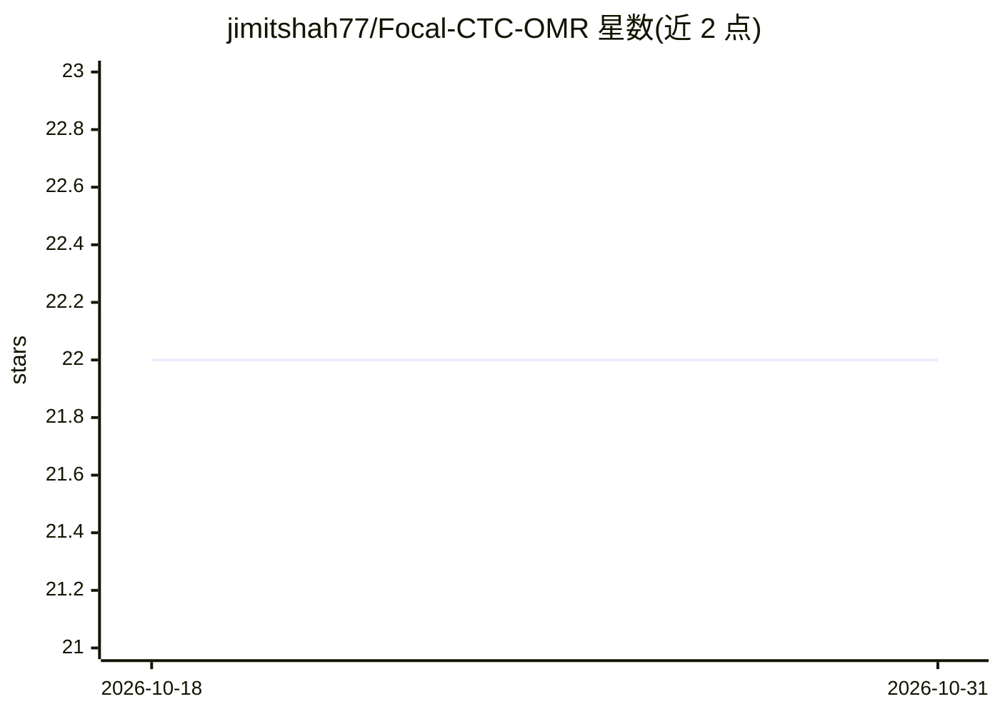

# jimitshah77/Focal-CTC-OMR

⭐ 22 · Jupyter Notebook · MIT · 推送 2026-03-03 · [GitHub](https://github.com/jimitshah77/Focal-CTC-OMR) · 个人维护

**科研：将 Focal Loss 思想融入 CTC 损失，用于光学乐谱识别的类不平衡问题**

论文 SangCTC（IEEE PuneCon 2019）Part I 的代码实现：针对端到端光学乐谱识别（OMR）中传统 CTC 损失在类不平衡数据集上的局限，提出 Focal CTC 损失函数（focal_ctc，含 alpha/gamma 参数），基于 CRNN 架构直接从乐谱图像训练到音乐转录序列，无需逐帧对齐。README 含问题背景、Focal CTC 代码片段（附梯度裁剪建议应对 nan 损失）、数据可视化与采样脚本说明，基代码源自 tf-end-to-end 仓库。

## 筛选速览

| 维度 | 判定 | 备注 |
|---|---|---|
| AI 角色 | `ai-native` | 本体是模型或模型工具 |
| 许可风险 | `permissive` | MIT |
| 部署形态 | `None` |  |
| 模型依赖 | — | README 未给出锁定关系 |
| 硬件要求 | — | 无带数字的原话,不猜 |
| 安装摩擦 | `low` | 无编译、无系统依赖或容器化 |
| 成熟度 | — | 结构信号不足 |

## 能力要点

- Focal CTC 损失函数实现（alpha/gamma 可调参数）
- 针对 OMR 类不平衡数据集的端到端 CRNN 训练
- 提供数据可视化与数据集采样脚本
- 附梯度爆炸（nan 损失）时对 ctc_loss 做裁剪的说明

## 适用场景

- 复现 SangCTC 论文的 Focal CTC 实验
- 研究序列识别任务中类不平衡的损失函数改进
- 基于 CRNN 做端到端乐谱识别实验

## 场景标签

 · 领域:计算机视觉/乐谱识别研究

## 证据(README 行号)

> L10: # Focal-CTC-OMR (22 Stars ⭐)
> L24: ### Solution: Focal CTC

## 星数曲线

2026-10-18 22 → 2026-10-31 22（+0）

---
*卡片 v1 · prompt 1.4 · 生成 2026-10-27 · 置信度 high · 依据 README sha `2cb3fe13b44c` · [字段定义](../../DATASET.md)*
