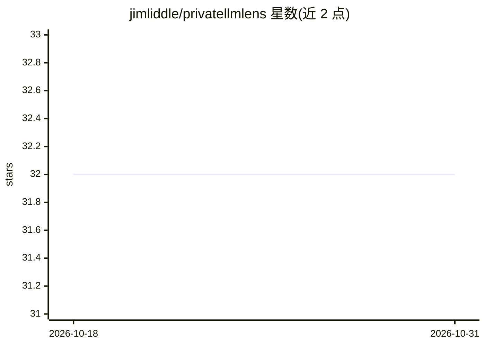

# jimliddle/privatellmlens

⭐ 32 · HTML · BSD-3-Clause · 推送 2026-10-15 · [GitHub](https://github.com/jimliddle/privatellmlens) · 个人维护

**零后端单文件浏览器界面：连接本地 Ollama/llama.cpp 聊天与文档问答**

单 HTML 文件的 Web 聊天界面，浏览器直连本地 Ollama 或 OpenAI 兼容的 llama.cpp 服务器，可在桌面与 Android/Termux 运行，无应用后端。提供流式对话、AES-256-GCM 加密的持久文档工作区（PDF/DOCX/PPTX/文本/CSV/HTML/Python/JSON）、BM25+本地 MiniLM 语义的混合检索与页级引用、加密记忆、浏览器本地工具调用。可选 Tavily/Perplexity/OpenAI/Gemini 云功能，密钥存于 WebCrypto vault。Android 上可经 llama.cpp/OpenCL 用 Adreno GPU 加速，或加载浏览器内 WebGPU 小模型。旧版 .doc/.ppt 不被解析，DOCX 提取不做 OCR。

## 筛选速览

| 维度 | 判定 | 备注 |
|---|---|---|
| AI 角色 | `ai-ecosystem` | LLM/agent 周边工具 |
| 许可风险 | `permissive` | BSD-3-Clause |
| 部署形态 | `library` | 以包/库形式分发 |
| 模型依赖 | local-ok | 支持本地模型 |
| 硬件要求 | — | 无带数字的原话,不猜 |
| 安装摩擦 | `low` | 无编译、无系统依赖或容器化 |
| 成熟度 | — | 结构信号不足 |

## 能力要点

- 单文件设计：界面、逻辑、PWA manifest 与图标全在 index.html
- 文档附件本地加密存储（AES-256-GCM），嵌入推理在浏览器内运行
- BM25 + 本地 all-MiniLM-L6-v2 混合检索，倒排融合与 MMR 去重
- Android Adreno GPU 加速（llama.cpp/OpenCL）与浏览器内 WebGPU 模型

## 适用场景

- 在桌面或 Android/Termux 上用本地模型进行私聊与文档问答
- 对加密文档工作区做带页/行级引用的检索问答
- 需要可选云搜索/图像生成但默认本地推理的使用方式

## 场景标签

`聊天机器人` `文档问答` · 领域:对话与助手

## 证据(README 行号)

> L5: PrivateLLMLens is a single-file browser interface for local Ollama, llama.cpp and optional in-browser WebGPU models.
> L33: The interface, styles, application logic, PWA manifest and icon live in `index.html`. Local inference requests go d

## 星数曲线

2026-10-18 32 → 2026-10-31 32（+0）

---
*卡片 v1 · prompt 1.4 · 生成 2026-10-26 · 置信度 mid · 依据 README sha `4022c0cb6034` · [字段定义](../../DATASET.md)*
