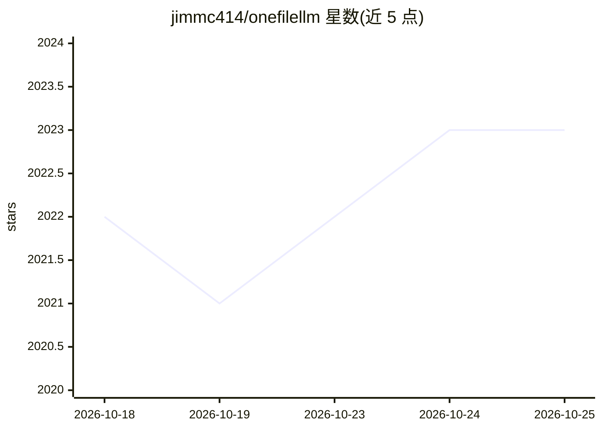

# jimmc414/onefilellm

⭐ 2,023 · Python · MIT · 推送 2026-06-12 · [GitHub](https://github.com/jimmc414/onefilellm) · 个人维护

**多源内容聚合为单一 XML 文件供 LLM 使用的命令行工具**

命令行工具，从本地文件、GitHub 仓库/PR/Issue、网页（含爬虫）、PDF、arXiv/DOI/PMID 论文、YouTube 字幕等多种来源抓取内容，聚合为单一结构化 XML 输出并复制到剪贴板，供大语言模型上下文使用。提供 CLI 与 Python API，可通过 pip 安装或源码运行。支持别名系统（含动态占位符）、爬虫深度/并发/robots.txt 等配置，可管道衔接 llm 工具做多阶段分析。YouTube 字幕提取依赖 yt-dlp 与 youtube-transcript-api，建议安装 Node.js。

## 筛选速览

| 维度 | 判定 | 备注 |
|---|---|---|
| AI 角色 | `ai-ecosystem` | LLM/agent 周边工具 |
| 许可风险 | `permissive` | MIT |
| 部署形态 | `library` | 以包/库形式分发 |
| 模型依赖 | — | README 未给出锁定关系 |
| 硬件要求 | — | 无带数字的原话,不猜 |
| 安装摩擦 | `low` | 无编译、无系统依赖或容器化 |
| 成熟度 | — | 结构信号不足 |

## 能力要点

- 聚合 GitHub 仓库/PR/Issue、网页爬虫、arXiv/DOI/PMID、YouTube 字幕等多源内容为单一 XML
- 别名系统支持动态占位符与别名组合复用
- 爬虫可配置深度、页数、并发、robots.txt 遵循等参数
- 提供 CLI、Python API 与管道式 llm 工具集成示例

## 适用场景

- 把整个代码仓库或文档站打包成单文件喂给 LLM
- 批量抓取 arXiv 论文做研究综述的上下文准备
- 用 cron 定时聚合多来源内容并接 LLM 生成研究简报

## 场景标签

`网页抓取` `文档解析` · 领域:效率与自动化

## 证据(README 行号)

> L3: Content Aggregator for LLMs - Aggregate and structure multi-source data into a single XML file for LLM context.
> L7: OneFileLLM is a command-line tool that automates data aggregation from various sources (local files, GitHub repos, w

## 星数曲线

2026-10-18 2,022 → 2026-10-25 2,023（+1）

---
*卡片 v1 · prompt 1.4 · 生成 2026-10-21 · 置信度 high · 依据 README sha `670ee0160e10` · [字段定义](../../DATASET.md)*
