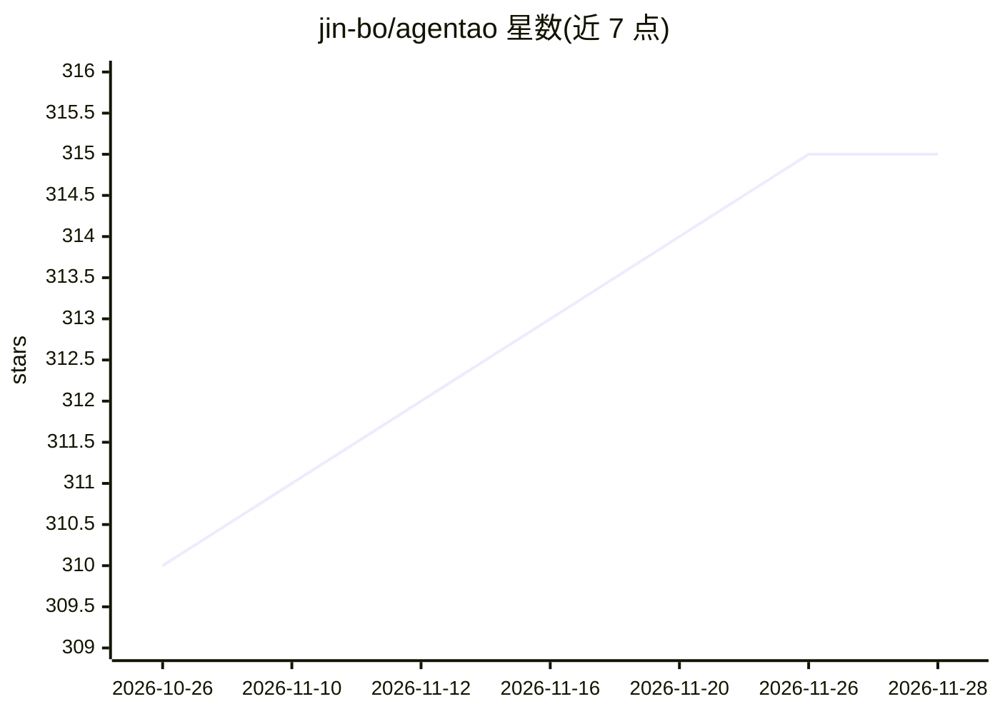

# jin-bo/agentao

⭐ 315 · Python · MIT · 推送 2026-11-23 · [GitHub](https://github.com/jin-bo/agentao) · [官网](https://agentao.cn) · 个人维护 · 中文 README

**Python 可嵌入的治理型本地 Agent 运行时，含 CLI 与 ACP 服务**

面向 Python 开发者的本地优先（local-first）Agent 运行时，可作为库嵌入应用、以 CLI REPL 运行，或作为 ACP（stdio JSON-RPC）服务器对外提供 Agent 能力。内置三块治理机制：约束（工具确认、四种权限模式、macOS sandbox-exec）、连接（MCP 工具协议、ACP、插件、hooks）、可观测性（实时思考展示、LLM 调用日志、JSONL 会话回放）。另提供 SQLite 持久记忆（含 jieba 中文分词）、技能自动发现与 GitHub 安装、子 Agent、会话恢复。要求 Python 3.10+，启动需配置 OpenAI 兼容的环境变量三件套。

## 筛选速览

| 维度 | 判定 | 备注 |
|---|---|---|
| AI 角色 | `ai-ecosystem` | LLM/agent 周边工具 |
| 许可风险 | `permissive` | MIT |
| 部署形态 | `library` | 以包/库形式分发 |
| 模型依赖 | locked-api |  |
| 硬件要求 | — | 无带数字的原话,不猜 |
| 安装摩擦 | `low` | 无编译、无系统依赖或容器化 |
| 成熟度 | — | 结构信号不足 |

## 能力要点

- 权限模式（read-only/workspace-write/full-access/plan）与工具确认、macOS sandbox
- MCP（stdio/Streamable HTTP/SSE）与 ACP（JSON-RPC）双协议
- SQLite 持久记忆（用户/项目双作用域，jieba 中文分词）与 JSONL 会话回放
- 技能从 skills/ 自动发现，支持 agentao skill install 从 GitHub 安装

## 适用场景

- 把带权限控制与审计回放的 Agent 能力嵌入自己的 Python 应用
- 在终端用 CLI 驱动多会话 Agent 并通过 JSONL 回放复盘执行过程
- 通过 MCP 接入外部工具、通过 ACP 与其他 Agent 互操作

## 场景标签

`Agent 框架` · 领域:Agent 开发

## 证据(README 行号)

> L13: > **Agentao** is a **Governed Agent Runtime** — a local-first, private-first, embeddable agent harness for Python h
> L86: |**Connectivity** (连接)|Agents must reach the world beyond training|MCP (stdio / Streamable HTTP / SSE) · ACP (full-
> L103: |**Embedding**|`Agentao(...)` constructor · `events()` stream · `active_permissions()` · capability injection · AC

## 星数曲线

2026-10-26 310 → 2026-11-28 315（+5）

---
*卡片 v1 · prompt 1.4 · 生成 2026-11-25 · 置信度 mid · 依据 README sha `0c512adb3ac4` · [字段定义](../../DATASET.md)*
