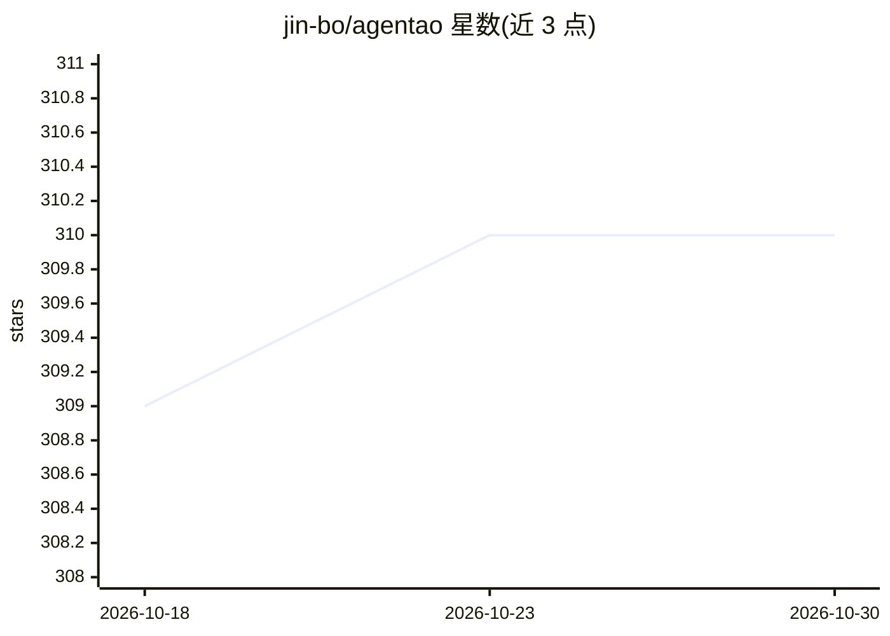

# jin-bo/agentao

⭐ 310 · Python · MIT · 推送 2026-10-29 · [GitHub](https://github.com/jin-bo/agentao) · [官网](https://agentao.cn) · 个人维护 · 中文 README

**面向 Python 开发者的本地优先受治理 AI agent 运行时**

Agentao 是一个可嵌入 Python 应用的受治理 agent 运行时（Governed Agent Runtime），也可作为 CLI 或 ACP 服务器运行。核心机制包括工具确认与四种权限模式（含 plan 模式与 macOS sandbox-exec）、MCP（stdio/Streamable HTTP/SSE）与 ACP 协议、SQLite 持久化记忆（jieba 中文分词）、JSONL 会话回放与子 agent。通过 pip 安装，要求 Python 3.10+ 与 OPENAI_API_KEY/BASE_URL/MODEL 三个环境变量；支持 Anthropic Messages API、OpenAI Responses API 及任意 OpenAI 兼容服务商。0.5.0 移除了 0.4.x 已弃用接口，提供迁移文档。

## 筛选速览

| 维度 | 判定 | 备注 |
|---|---|---|
| AI 角色 | `ai-ecosystem` | LLM/agent 周边工具 |
| 许可风险 | `permissive` | MIT |
| 部署形态 | `library` | 以包/库形式分发 |
| 模型依赖 | locked-api |  |
| 硬件要求 | — | 无带数字的原话,不猜 |
| 安装摩擦 | `low` | 无编译、无系统依赖或容器化 |
| 成熟度 | — | 结构信号不足 |

## 能力要点

- 四种权限模式（read-only/workspace-write/full-access/plan）与 macOS sandbox-exec
- MCP 与 ACP 协议支持，技能可从 GitHub 安装
- SQLite 持久记忆（用户/项目两级）与 JSONL 会话回放
- 可嵌入（Agentao 构造器、events 流）或作为 CLI/ACP 服务器运行

## 适用场景

- 在我的 Python 应用中嵌入带权限控制的 agent 能力
- 通过终端 CLI 驱动受治理的编码 agent 并回放会话
- 以 ACP 服务器形式对外提供完整 agent 服务

## 场景标签

`Agent 框架` `Agent 记忆` · 领域:Agent 开发

## 证据(README 行号)

> L13: > **Agentao** is a **Governed Agent Runtime** — a local-first, private-first, embeddable agent harness for Python h
> L39: pip install agentao
> L86: |**Connectivity** (连接)|Agents must reach the world beyond training|MCP (stdio / Streamable HTTP / SSE) · ACP (full-

## 星数曲线

2026-10-18 309 → 2026-10-30 310（+1）

---
*卡片 v1 · prompt 1.4 · 生成 2026-10-21 · 置信度 mid · 依据 README sha `4476d102d23a` · [字段定义](../../DATASET.md)*
