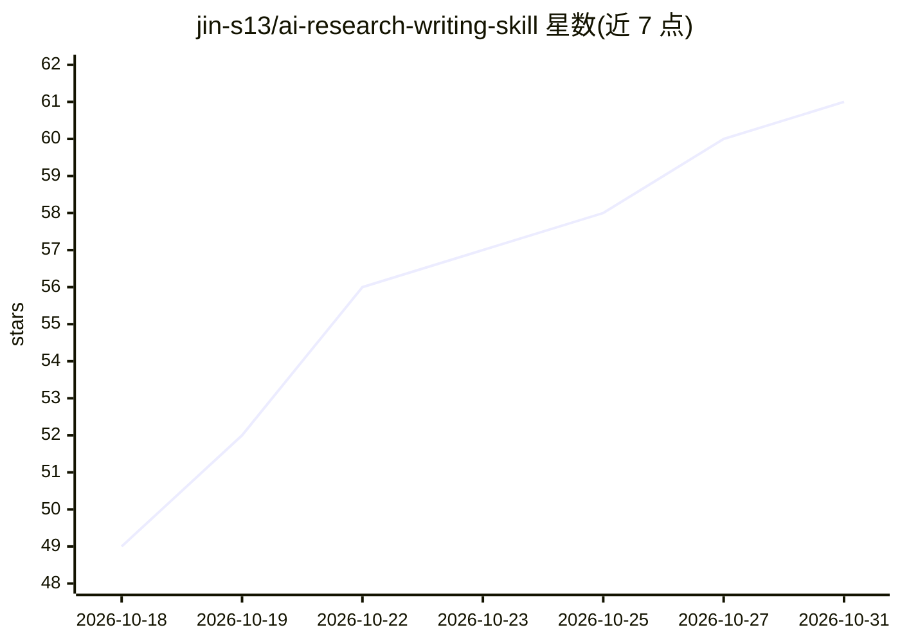

# jin-s13/ai-research-writing-skill

⭐ 61 · Python · MIT · 推送 2026-10-18 · [GitHub](https://github.com/jin-s13/ai-research-writing-skill) · 个人维护 · 中文 README

**面向 ML/AI 研究者的 agent 技能：把代码仓库转为证据支撑的论文包**

一个以根目录 SKILL.md 为唯一入口的编码 agent 技能包：将 agent 指向代码、实验日志、笔记与会议模板，产出论文故事、claim-evidence 映射、经核验的 BibTeX（arXiv/DOI/Semantic Scholar）、概念图与确定性结果图表、审稿人风格评论及 LaTeX 构建检查。内置质量门禁（证据、引用核验、构建等），附 Python stdlib 辅助脚本与端到端示例论文。支持 NeurIPS/ICML/CVPR/ACL 等会议模板，从官方来源获取并 SHA-256 校验。通过 git clone 安装为本地技能。

## 筛选速览

| 维度 | 判定 | 备注 |
|---|---|---|
| AI 角色 | `ai-ecosystem` | LLM/agent 周边工具 |
| 许可风险 | `permissive` | MIT |
| 部署形态 | `None` |  |
| 模型依赖 | — | README 未给出锁定关系 |
| 硬件要求 | — | 无带数字的原话,不猜 |
| 安装摩擦 | `low` | 无编译、无系统依赖或容器化 |
| 成熟度 | — | 结构信号不足 |

## 能力要点

- claim-evidence 映射：每条声明可追溯到代码/日志/引用
- BibTeX 从 arXiv / DOI / Semantic Scholar 获取并核验
- 内置 7 类质量门禁（证据/故事/文献/引用/图/审稿/构建）
- 覆盖 NeurIPS、ICML、CVPR、ACL 等会议模板，官方来源加 SHA-256 校验

## 适用场景

- 把手头的 ML/AI 研究仓库转成可构建的会议论文 LaTeX 草稿
- 让 agent 以审稿人视角评审论文草稿并定位拒稿风险
- 投稿前运行引用、构建、打包与清单检查

## 场景标签

`AI 写作` `科研工具` · 领域:内容生成

## 证据(README 行号)

> L12: Point your coding agent at code, experiment logs, notes, and a venue template. This skill helps it produce an audit
> L129: **Simple rule:** the only canonical entrypoint is the root `SKILL.md`.

## 星数曲线

2026-10-18 49 → 2026-10-31 61（+12）

---
*卡片 v1 · prompt 1.4 · 生成 2026-10-24 · 置信度 high · 依据 README sha `ca1c11df4d9c` · [字段定义](../../DATASET.md)*
