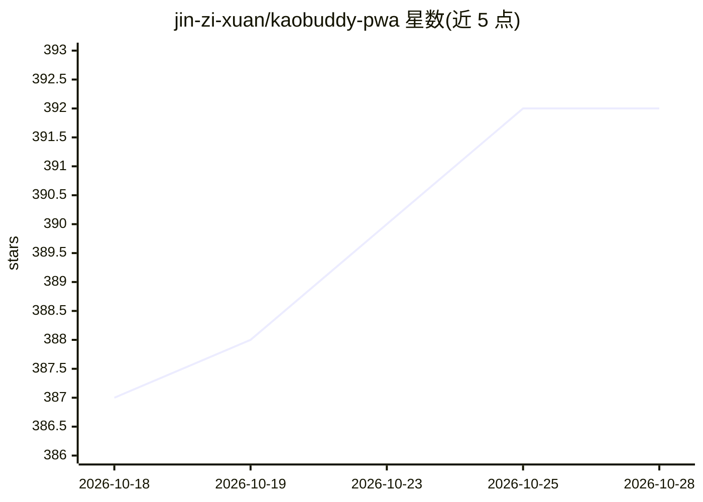

# jin-zi-xuan/kaobuddy-pwa

⭐ 392 · TypeScript · 推送 2026-09-17 · [GitHub](https://github.com/jin-zi-xuan/kaobuddy-pwa) · 个人维护 · 中文 README

**给临时抱佛脚者的 AI 备考工作台，BYOK 自带 Key**

面向临近考试用户的 PWA 备考工具：导入 PDF、DOCX、手写照片、B 站字幕等资料，AI 拆解知识点并生成每日计划、讲解、模拟题、模拟考批改、学习卡片与临考速背卡片，错题自动入库。采用 BYOK 模式，内置 DeepSeek/Kimi/OpenAI 预设及自定义 OpenAI-compatible 接入，数据存浏览器 IndexedDB，无账号无云同步。提供 Windows 免安装便携包、源码运行脚本与 Docker/Fly.io/Railway 部署配置；后端 FastAPI 转发 AI 请求。macOS 未提供安装包（无签名会被拦截）。

## 筛选速览

| 维度 | 判定 | 备注 |
|---|---|---|
| AI 角色 | `ai-native` | 本体是模型或模型工具 |
| 许可风险 | `none` | — |
| 部署形态 | `self-host` | docker 或自建部署 |
| 模型依赖 | locked-api |  |
| 硬件要求 | — | 无带数字的原话,不猜 |
| 安装摩擦 | `low` | 无编译、无系统依赖或容器化 |
| 成熟度 | `idea` | |

## 能力要点

- AI 从资料抽取知识点，按考试日期与目标分数拆分优先级
- 模拟考生成、AI 批改、错题本与临考速背卡片
- BYOK：API Key 存 localStorage，数据存浏览器 IndexedDB
- 支持 PDF/DOCX/RTF/手写图片视觉识别/B 站字幕导入

## 适用场景

- 考前两周把杂乱课件和往年题快速变成可学的知识点计划
- AI 出模拟考并批改，错题自动入库复习
- 考前最后一天用速背卡片快速过知识点

## 场景标签

`文档问答` · 领域:知识与检索

## 证据(README 行号)

> L5: 你把课件、教材、往年题、笔记、PDF、手写照片、视频字幕扔进来，剩下的交给 AI——拆知识点、讲重点、出题、批改、生成模拟考、临考速背卡片。自己带 API Key，数据全在浏览器里，目前不搞账号，以后再弄。
> L22: - 针对单个知识点讲解、生成学习卡片、出模拟题——不是泛泛的"本章复习"。
> L30: 内置四个预设，填 API Key 就能开始：

## 星数曲线

2026-10-18 387 → 2026-10-28 392（+5）

---
*卡片 v1 · prompt 1.4 · 生成 2026-10-22 · 置信度 high · 依据 README sha `ffedefceafae` · [字段定义](../../DATASET.md)*
