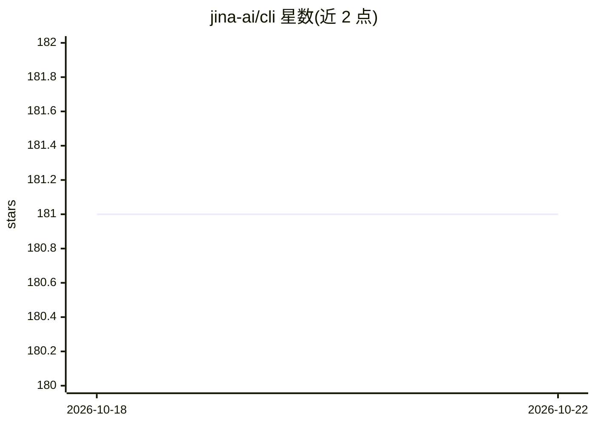

# jina-ai/cli

⭐ 181 · Python · Apache-2.0 · 推送 2026-08-03 · [GitHub](https://github.com/jina-ai/cli) · [官网](https://jina.ai) · 组织维护

**把 Jina AI 各 API 封装成 Unix 管道命令的 CLI**

面向人类与 AI agent 的命令行工具，将 Jina AI 的网页读取、搜索、嵌入、重排、分类、去重、截图、BibTeX 检索、PDF 抽取等 API 封装为可经 stdin/stdout 管道组合的 Unix 命令，统一 --json 输出、退出码与 --help 分层自发现，使有 shell 权限的 agent 用单一 run(command) 替代多套工具定义。多数命令需 JINA_API_KEY；embed/rerank/classify/dedup 支持 --local 在 Apple Silicon 经 jina-grep 嵌入服务器本地运行。

## 筛选速览

| 维度 | 判定 | 备注 |
|---|---|---|
| AI 角色 | `ai-ecosystem` | LLM/agent 周边工具 |
| 许可风险 | `permissive` | Apache-2.0 |
| 部署形态 | `library` | 以包/库形式分发 |
| 模型依赖 | — | README 未给出锁定关系 |
| 硬件要求 | — | 无带数字的原话,不猜 |
| 安装摩擦 | `low` | 无编译、无系统依赖或容器化 |
| 成熟度 | — | 结构信号不足 |

## 能力要点

- 全部命令经 stdin/stdout 管道组合，支持 --json 结构化输出
- 语义 grep（jina grep）基于本地 MLX 嵌入，兼容多数 GNU grep 标志
- --local 模式在 Apple Silicon 本地运行嵌入/重排/分类/去重，无需 API key
- 面向 agent 的分层 --help 自发现与带修复指引的错误消息

## 适用场景

- 在脚本和管道中调用 Jina 搜索、读取、嵌入、重排等能力
- 让有 shell 权限的 AI agent 用单一命令替代多套工具定义
- 在代码库中做语义 grep 检索

## 场景标签

 · 领域:LLM 工具/信息检索

## 证据(README 行号)

> L7: This CLI is designed for both humans and AI agents. An agent with shell access needs only `run(command="jina search 
> L158: An agent with shell access can use this CLI directly:

## 星数曲线

2026-10-18 181 → 2026-10-22 181（+0）

---
*卡片 v1 · prompt 1.4 · 生成 2026-10-22 · 置信度 high · 依据 README sha `89c1508b2558` · [字段定义](../../DATASET.md)*
