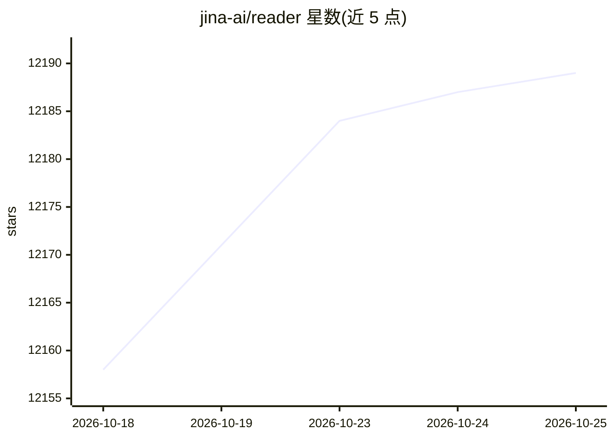

# jina-ai/reader

⭐ 12,189 · TypeScript · Apache-2.0 · 推送 2026-05-22 · [GitHub](https://github.com/jina-ai/reader) · [官网](https://jina.ai/reader) · 组织维护

**把任意 URL/文件转为 LLM 友好输入，并提供网页搜索服务**

Jina AI 的开源 Reader：通过 URL 前缀 https://r.jina.ai/ 将网页（headless Chrome/curl-impersonate 自动选择）、PDF（PDF.js）、MS Office 文档（LibreOffice 转换）与图片（视觉语言模型生成描述）转为 markdown/HTML/文本等格式，并通过 https://s.jina.ai/ 提供搜索前 5 条结果的全文抓取。面向构建 agent 与 RAG 系统的开发者，通过大量请求头控制输出格式、图片/链接保留策略、语义分块与 token 预算。本仓库为无状态或 bucket 缓存模式的开源分支，不含 SaaS 的 MongoDB 存储层。

## 筛选速览

| 维度 | 判定 | 备注 |
|---|---|---|
| AI 角色 | `ai-ecosystem` | LLM/agent 周边工具 |
| 许可风险 | `permissive` | Apache-2.0 |
| 部署形态 | `self-host` | docker 或自建部署 |
| 模型依赖 | — | README 未给出锁定关系 |
| 硬件要求 | — | 无带数字的原话,不猜 |
| 安装摩擦 | `low` | 无编译、无系统依赖或容器化 |
| 成熟度 | — | 结构信号不足 |

## 能力要点

- 网页/PDF/Office 文档/图片统一转为 LLM 友好格式
- 搜索端点自动抓取 top 5 结果全文而非仅标题链接
- 丰富请求头：输出格式、图片链接保留、语义分块、token 预算
- x-preset 预设（index/research/agent/spider 等）适配不同场景

## 适用场景

- 为 RAG 管线把网页和 PDF 转成干净的 markdown
- 让 agent 通过一个前缀即可读取网页与搜索结果
- 控制输出 token 量以适配固定上下文窗口

## 场景标签

`文档解析` `网页抓取` · 领域:效率与自动化

## 证据(README 行号)

> L9: - **Read**: It converts any URL to an **LLM-friendly** input with `https://r.jina.ai/https://your.url`. Get improved
> L10: - **Search**: It searches the web for a given query with `https://s.jina.ai/your+query`. This allows your LLMs to a
> L21: > This repository is the open source branch of the codebase behind `https://r.jina.ai` and `https://s.jina.ai`. It 

## 星数曲线

2026-10-18 12,158 → 2026-10-25 12,189（+31）

---
*卡片 v1 · prompt 1.4 · 生成 2026-10-20 · 置信度 mid · 依据 README sha `ecca5f4d89f1` · [字段定义](../../DATASET.md)*
