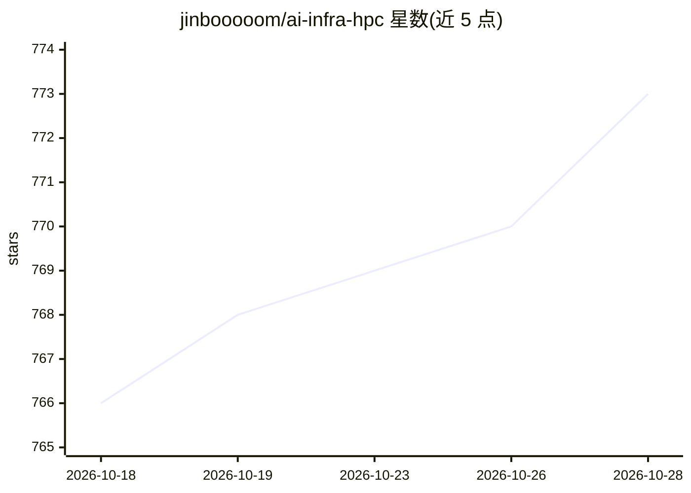

# jinbooooom/ai-infra-hpc

⭐ 775 · Cuda · MIT · 推送 2026-04-27 · [GitHub](https://github.com/jinbooooom/ai-infra-hpc) · [官网](https://github.com/jinbooooom/ai-infra-hpc) · 个人维护 · 中文 README

**AI-Infra/HPC 底层技术学习笔记：CUDA、NCCL、RDMA、并行训练**

个人维护的 AI 基础设施与高性能计算技术学习总结仓库，以目录式笔记组织：CUDA 编程（执行模型、内存层次、流与并发、Nsight 与 CUDA-GDB 调试）、GPU 互联（NVLink/NVSwitch）、GPUDirect（GDS/P2P/RDMA、NVSHMEM）、RDMA 原理与部署、NCCL 集合通信算法与源码分析、训练与推理（并行策略、ZeRO、DeepEP、显存估算）。覆盖单机编程到千卡集群互联的知识点，不含可运行代码工程。

## 筛选速览

| 维度 | 判定 | 备注 |
|---|---|---|
| AI 角色 | `ai-knowledge` | 知识聚合/清单类 |
| 许可风险 | `permissive` | MIT |
| 部署形态 | `None` |  |
| 模型依赖 | — | README 未给出锁定关系 |
| 硬件要求 | — | 无带数字的原话,不猜 |
| 安装摩擦 | `medium` | 含编译或系统依赖之一 |
| 成熟度 | — | 结构信号不足 |

## 能力要点

- CUDA 编程与调试（Nsight 性能分析、CUDA-GDB）知识总结
- NCCL 集合通信算法（Ring/Tree/Bruck）与源码分析笔记
- RDMA 原理、环境部署与性能优化方法整理
- 并行训练策略（DP/Tensor/流水线并行、ZeRO、DeepEP）要点

## 适用场景

- 系统性学习 GPU 集群互联与集合通信底层原理
- 排查 RDMA/NCCL 多机训练通信问题时查阅原理与命令
- 了解大模型训练的显存估算与并行技术路线

## 场景标签

`教程课程` · 领域:学习与行业

## 证据(README 行号)

> L2: ### 本仓库用于记录 AI-Infra 与 HPC 技术：
> L19: ## CUDA 总结
> L293: ## NCCL 总结

## 星数曲线

2026-10-18 766 → 2026-10-28 773（+7）

---
*卡片 v1 · prompt 1.4 · 生成 2026-10-21 · 置信度 high · 依据 README sha `3f48a5fc1a89` · [字段定义](../../DATASET.md)*
