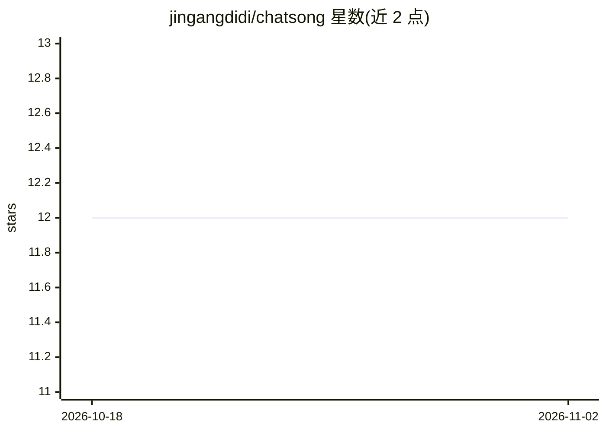

# jingangdidi/chatsong

⭐ 12 · Rust · Apache-2.0 · 推送 2026-11-01 · [GitHub](https://github.com/jingangdidi/chatsong) · 个人维护 · 中文 README

**单文件 LLM 对话服务端：浏览器多模型聊天与工具调用**

以约 10M 单个可执行文件形式提供的 LLM API 调用工具：下载预编译二进制、编写 config.txt 后运行即可在本机或内网启动服务，浏览器访问使用。支持在配置中自定义多家模型（OpenAI、Claude、Gemini、DeepSeek、通义千问、Kimi、GLM 等 OpenAI 兼容 API，含 llama-server 提供的本地模型）与 prompt；同一会话内可切换模型。功能含 web 搜索与 URL 读取、zip/html/pdf/文本解析、内置文件系统工具、自定义外部工具与 MCP stdio 工具、规划模式、技能、Qwen3-ASR 与 OmniVoice-TTS 语音（需编译时开启特性）、Discord bot、token 统计与历史消息摘要压缩。数据本地存储，Rust 编写，可从源码 cargo 构建。

## 筛选速览

| 维度 | 判定 | 备注 |
|---|---|---|
| AI 角色 | `ai-native` | 本体是模型或模型工具 |
| 许可风险 | `permissive` | Apache-2.0 |
| 部署形态 | `None` |  |
| 模型依赖 | locked-api |  |
| 硬件要求 | — | 无带数字的原话,不猜 |
| 安装摩擦 | `high` | 编译与系统依赖俱全 |
| 成熟度 | — | 结构信号不足 |

## 能力要点

- 单文件可执行（~10M），无需安装，数据本地存储
- 统一接入多家 LLM API 及 OpenAI 兼容格式（DeepSeek/Qwen/GLM/Kimi 等），同一会话可切换模型
- 内置文件系统工具 + 自定义外部工具 + MCP stdio 工具 + 规划模式 + 技能
- 可选编译特性支持 Qwen3-ASR 语音识别与 OmniVoice-TTS（含语音克隆），支持 CUDA/Metal/CPU 推理

## 适用场景

- 在内网机器上快速部署一个多模型 LLM 对话服务供浏览器访问
- 带工具调用与 MCP 的日常对话和任务处理（文件操作、网页读取）
- 配合 llama-server 等本地模型端点做本地化对话
- 用语音唤醒词进行语音问答（需自行编译带 ASR/TTS 特性）

## 场景标签

`聊天机器人` `AI 助手` `语音 Agent` · 领域:对话与助手

## 证据(README 行号)

> L6: **A lightweight(~10M), portable executable for invoking LLM with multi-API support - eliminating installation requir
> L8: **轻量级大语言模型OpenAI格式api调用工具，无需安装，仅一个~10M可执行文件，支持自定义多种模型（OpenAI、Claude、Gemini、DeepSeek等，以及第三方提供的api）和prompt。**
> L54: ./chatsong

## 星数曲线

2026-10-18 12 → 2026-11-02 12（+0）

---
*卡片 v1 · prompt 1.4 · 生成 2026-11-01 · 置信度 high · 依据 README sha `a89f300f7b96` · [字段定义](../../DATASET.md)*
