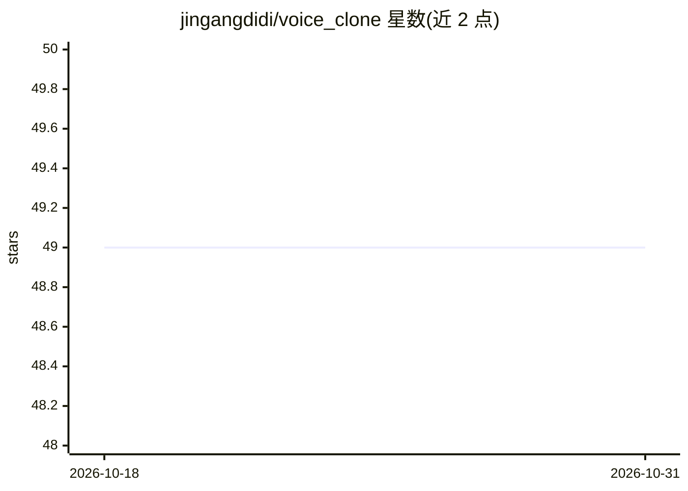

# jingangdidi/voice_clone

⭐ 49 · Rust · MIT · 推送 2026-01-18 · [GitHub](https://github.com/jingangdidi/voice_clone) · 个人维护 · 中文 README

**单文件可执行的声音克隆工具，基于 OpenVoice 转换音色**

基于 OpenVoice 模型的声音克隆/音色转换命令行工具，以约 14M 的单文件可执行程序分发，运行时不依赖 ffmpeg、Python、PyTorch、ONNX。支持 mp4/mp3/wav 等格式输入，内置 11 种基础说话人音色，也可用自定义音频作为目标音色；支持提取并缓存 .tone 音色文件、输出源与目标音色的余弦相似度。支持 CPU 与 GPU（CUDA），GPU 下约 1.6 秒完成转换。底层用 Rust candle 实现，源码可用 cargo 编译。

## 筛选速览

| 维度 | 判定 | 备注 |
|---|---|---|
| AI 角色 | `ai-native` | 本体是模型或模型工具 |
| 许可风险 | `permissive` | MIT |
| 部署形态 | `None` |  |
| 模型依赖 | — | README 未给出锁定关系 |
| 硬件要求 | — | 无带数字的原话,不猜 |
| 安装摩擦 | `high` | 编译与系统依赖俱全 |
| 成熟度 | — | 结构信号不足 |

## 能力要点

- 单文件可执行（约 14M），无需安装 ffmpeg/Python/PyTorch/ONNX
- 支持 mp4/mp3/wav 等多格式输入与批量转换
- 内置 11 种基础说话人音色，也可克隆自定义音色
- 支持 CPU 与 GPU（CUDA），并可提取缓存 .tone 音色文件

## 适用场景

- 把一段语音的音色转换成内置说话人或我自己的声音
- 批量将多个音视频文件的音色统一替换
- 在无 Python 环境的机器上离线做声音克隆

## 场景标签

`语音合成` · 领域:内容生成

## 证据(README 行号)

> L6: **An OpenVoice-based voice cloning tool, single executable file (~14M), supporting multiple formats without dependen
> L37: ./voice_clone -s raw_voice.wav -t your_voice.wav

## 星数曲线

2026-10-18 49 → 2026-10-31 49（+0）

---
*卡片 v1 · prompt 1.4 · 生成 2026-10-24 · 置信度 high · 依据 README sha `bcdc135498e2` · [字段定义](../../DATASET.md)*
