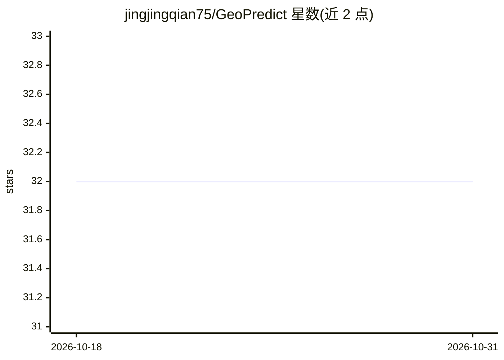

# jingjingqian75/GeoPredict

⭐ 32 · Python · Apache-2.0 · 推送 2026-10-14 · [GitHub](https://github.com/jingjingqian75/GeoPredict) · [官网](https://jingjingqian75.github.io/GeoPredict-Page/) · 组织维护 · 中文 README

**面向机器人操作的三维几何感知 VLA 框架，CVPR 2026 论文官方代码**

GeoPredict 是一个 geometry-aware 的 vision-language-action（VLA）机器人操作框架，配套 CVPR 2026 Highlight 论文的官方实现。框架由三部分组成：轨迹级运动学预测（Track Encoder 编码机器人关键点运动历史并预测多步 3D 关键点轨迹）、预测式 3D 高斯几何（解码空间查询为高斯基元并预测场景演化）、以及沿预测轨迹做 track-guided 细化、仅用未来深度图渲染监督。预测模块仅用于训练，推理时开销降低。提供推理代码、checkpoint、训练代码与 RoboCasa 数据集（发布于 ModelScope），在 RoboCasa 与 LIBERO 仿真基准上报告结果。

## 筛选速览

| 维度 | 判定 | 备注 |
|---|---|---|
| AI 角色 | `ai-native` | 本体是模型或模型工具 |
| 许可风险 | `permissive` | Apache-2.0 |
| 部署形态 | `None` |  |
| 模型依赖 | — | README 未给出锁定关系 |
| 硬件要求 | — | 无带数字的原话,不猜 |
| 安装摩擦 | `low` | 无编译、无系统依赖或容器化 |
| 成熟度 | — | 结构信号不足 |

## 能力要点

- 轨迹级运动学预测：Track Encoder + 可学习 future track queries 生成多步 3D 关键点轨迹
- 预测式 3D 高斯几何建模工作空间并预测其未来演化
- 预测模块仅用于训练阶段，降低测试时开销
- 已发布推理代码、checkpoint、训练代码与数据集

## 适用场景

- 机器人在仿真环境（RoboCasa/LIBERO）中执行几何与空间要求高的操作任务
- 复现或扩展论文的预测式运动学与 3DGS 方法做机器人学习研究
- 基于发布的训练代码与数据集训练自己的 VLA 操作模型

## 场景标签

 · 领域:机器人学/具身智能

## 证据(README 行号)

> L25: **GeoPredict** is a geometry-aware vision-language-action (VLA) framework for robotic manipulation.
> L54: - **(a) Trajectory-Level Kinematic Prediction**: encodes motion history of robot keypoints into compact tokens via 

## 星数曲线

2026-10-18 32 → 2026-10-31 32（+0）

---
*卡片 v1 · prompt 1.4 · 生成 2026-10-26 · 置信度 high · 依据 README sha `595e9c224bf8` · [字段定义](../../DATASET.md)*
