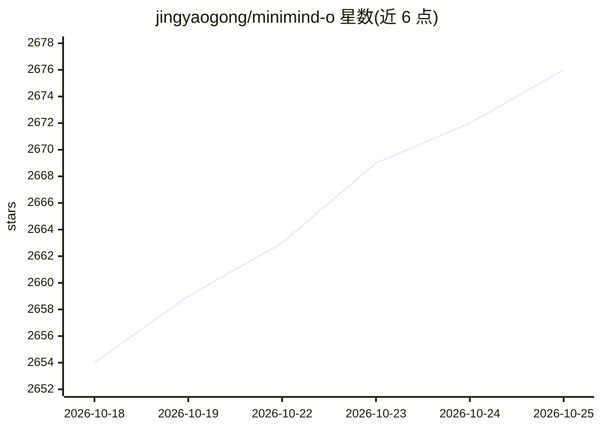

# jingyaogong/minimind-o

⭐ 2,677 · Python · Apache-2.0 · 推送 2026-09-22 · [GitHub](https://github.com/jingyaogong/minimind-o) · [官网](https://jingyaogong.github.io/minimind-o) · 个人维护 · 中文 README

**从 0 训练的 0.1B 级端到端 Omni 模型：能听、能看、能说**

MiniMind 系列的第三站：提供约 0.1B 参数的端到端 Omni 模型完整实现，单一权重支持文/音/图三模态输入与文本/流式语音输出。架构采用 Thinker–Talker 双路径，Talker 用 MTP 预测 8 层 Mimi audio codes，配合 VAD 支持实时打断与近似双工交互；音频/视觉特征由冻结的 SenseVoice-Small 与 SigLIP2 提取。核心代码用 PyTorch 原生实现，开源 mini 与 full 两套训练数据，mini 单卡 RTX 3090 约 2 小时跑通；限制是 0.06B 主干在复杂知识问答与推理上不构成竞争力，较长英文语音易出现读音漂移。

## 筛选速览

| 维度 | 判定 | 备注 |
|---|---|---|
| AI 角色 | `ai-native` | 本体是模型或模型工具 |
| 许可风险 | `permissive` | Apache-2.0 |
| 部署形态 | `library` | 以包/库形式分发 |
| 模型依赖 | — | README 未给出锁定关系 |
| 硬件要求 | — | 无带数字的原话,不猜 |
| 安装摩擦 | `medium` | 含编译或系统依赖之一 |
| 成熟度 | — | 结构信号不足 |

## 能力要点

- Thinker–Talker 双路径 + MTP 预测多层 Mimi codes，24 kHz 流式语音生成
- 音色克隆（in-context voice cloning）、实时打断、电话模式 WebUI
- mini 数据集单卡 3090 约 2 小时跑通完整训练链路，CPU 可推理
- 核心算法从 0 用 PyTorch 原生实现，兼容 transformers 格式权重

## 适用场景

- 从第一行代码读起，自己动手从 0 训练一个 Omni 模型
- 在个人 GPU 上复现流式语音交互与音色克隆实验
- 学习 Thinker–Talker 架构与多模态注入的实现细节

## 场景标签

`多模态` `语音合成` `模型训练` · 领域:内容生成

## 证据(README 行号)

> L15: * 此开源项目旨在从 0 完整实现一个小规模的端到端 Omni 模型，单一权重同时支持文 / 音 / 图三模态输入与文本 / 流式语音输出。
> L32: 继 MiniMind（LLM）和 MiniMind-V（VLM）之后，MiniMind-O 是这个系列的第三站。所谓 Omni，就是让一个模型同时具备听、看、说的多模态交互能力：接收文本、语音和视觉信号，输出文本与流式语音。
> L42: - 提供完整的 MiniMind-O 结构代码：Thinker、独立 Talker、audio / vision projector、Mimi codebook 接口以及 MTP audio head。

## 星数曲线

2026-10-18 2,654 → 2026-10-25 2,676（+22）

---
*卡片 v1 · prompt 1.4 · 生成 2026-10-21 · 置信度 high · 依据 README sha `bb321332991d` · [字段定义](../../DATASET.md)*
