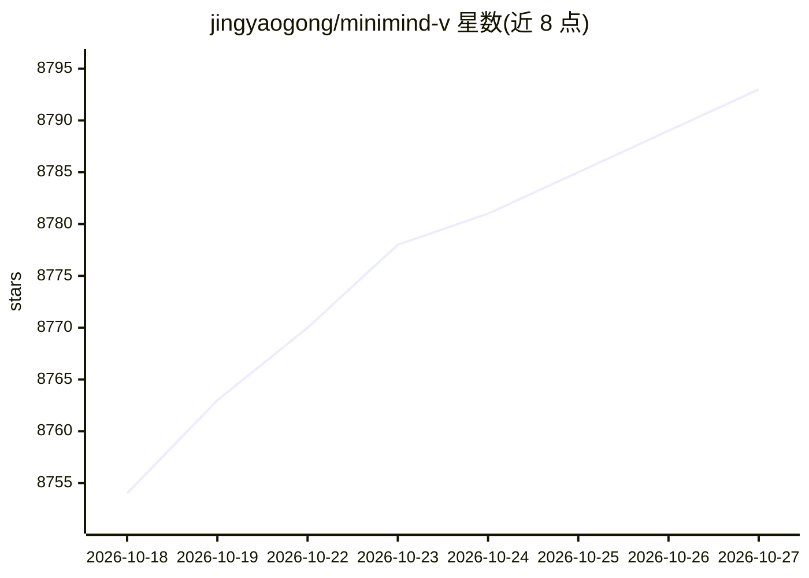

# jingyaogong/minimind-v

⭐ 8,793 · Python · Apache-2.0 · 推送 2026-09-22 · [GitHub](https://github.com/jingyaogong/minimind-v) · [官网](https://jingyaogong.github.io/minimind-v) · 个人维护 · 中文 README

**从0训练65M参数超小视觉语言模型的教程与全流程代码**

MiniMind-V 是一个开源的极小规模视觉语言模型（VLM）及其完整训练实现：基于 MiniMind 语言模型权重作主干，接 SigLIP2 视觉编码器（全程冻结）加 MLP Projection，可训练部分约 65M，推理整机约 160M（dense）。提供数据集清洗、Pretrain（可选）、SFT、断点续训、DDP 多卡、WebUI 推理等全过程脚本，单张 3090 上 SFT 单 epoch 实测约 2 小时。定位为个人 GPU 可训可推理的入门教程与最小实现，训练数据来自 ALLaVA-4V 中英双语图文数据（约 290 万条 SFT）。

## 筛选速览

| 维度 | 判定 | 备注 |
|---|---|---|
| AI 角色 | `ai-native` | 本体是模型或模型工具 |
| 许可风险 | `permissive` | Apache-2.0 |
| 部署形态 | `library` | 以包/库形式分发 |
| 模型依赖 | — | README 未给出锁定关系 |
| 硬件要求 | — | 无带数字的原话,不猜 |
| 安装摩擦 | `medium` | 含编译或系统依赖之一 |
| 成熟度 | — | 结构信号不足 |

## 能力要点

- 65M 可训练参数（LLM 64M + Projection 1M），SigLIP2 视觉编码器全程冻结
- 单张 RTX 3090 上 SFT 1 epoch 实测约 2 小时、租用成本约 3 元
- SFT 数据约 290 万条（ALLaVA-4V，中英均衡，Pretrain 已并入为子集）
- 支持 DDP 多卡、bfloat16 混合精度、torch.compile、断点续训与 WebUI

## 适用场景

- 在自己 GPU 上从零训练一个识图对话的迷你 VLM
- 学习 VLM 结构（视觉编码器 + Projection + LLM）的极简实现
- 作为视觉语言模型入门教程跑通 Pretrain/SFT 全流程

## 场景标签

`教程课程` `多模态` `模型训练` · 领域:学习与行业

## 证据(README 行号)

> L16: * 此项目旨在从0开始，仅用3块钱成本 + 2小时！即可训练出65M参数的超小多模态视觉语言模型**MiniMind-V**。
> L19: * 项目同时包含了VLM大模型的极简结构、数据集清洗、Pretrain、SFT等全过程代码。
> L20: * 这不仅是一个开源VLM模型的最小实现，也是入门视觉语言模型的简明教程。

## 星数曲线

2026-10-18 8,754 → 2026-10-27 8,793（+39）

---
*卡片 v1 · prompt 1.4 · 生成 2026-10-20 · 置信度 mid · 依据 README sha `54ee7a219539` · [字段定义](../../DATASET.md)*
