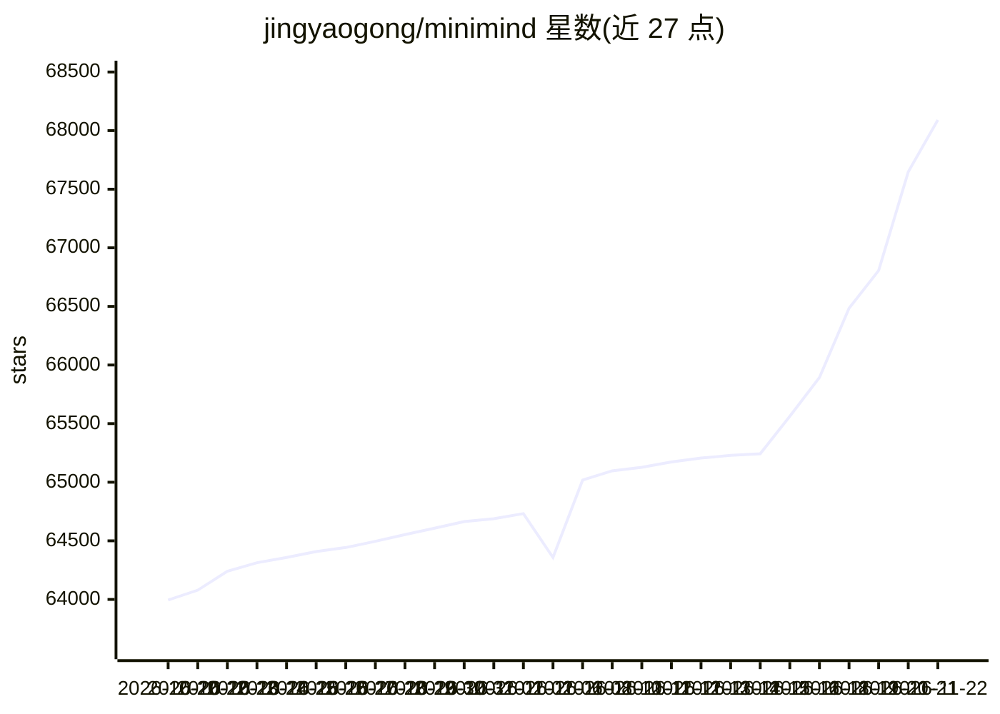

# jingyaogong/minimind

⭐ 68,091 · Python · Apache-2.0 · 推送 2026-11-21 · [GitHub](https://github.com/jingyaogong/minimind) · [官网](https://jingyaogong.github.io/minimind) · 个人维护 · 中文 README

**从零训练 64M 小型语言模型的开源教程项目**

提供从零训练约 64M 参数语言模型 MiniMind 的完整代码与数据，覆盖分词器训练、预训练、SFT、LoRA、DPO/PPO/GRPO 等 RLHF/RLAIF 阶段及 Tool Use、蒸馏，核心算法以 PyTorch 原生实现。结构对齐 Qwen3 生态，兼容 transformers/trl/peft 与 llama.cpp、vllm、ollama 推理引擎，附带 OpenAI 协议服务端和 Streamlit WebUI。面向希望理解 LLM 内部机制的入门者与个人开发者，README 注明 2 小时指单张 3090 上 SFT 一轮的实测耗时。

## 筛选速览

| 维度 | 判定 | 备注 |
|---|---|---|
| AI 角色 | `ai-native` | 本体是模型或模型工具 |
| 许可风险 | `permissive` | Apache-2.0 |
| 部署形态 | `library` | 以包/库形式分发 |
| 模型依赖 | local-ok | 支持本地模型 |
| 硬件要求 | — | 无带数字的原话,不猜 |
| 安装摩擦 | `medium` | 含编译或系统依赖之一 |
| 成熟度 | `idea` | |

## 动量与使用信号

- 维护:`active` — 距上次 push 25.6 天,年发版 1,19 位贡献者
- 涨星:近 1 天 **+63**(自 20261016 起算)
- 安装:pypi 包 `streamlit` 月下载 19,368,322
- 平台:WEB · 协议:OPENAI-API / OLLAMA

## 能力要点

- 覆盖 Pretrain/SFT/LoRA/RLHF-DPO/RLAIF/Tool Use/蒸馏全流程代码
- 核心算法从 0 用 PyTorch 原生实现，不依赖高层抽象接口
- 兼容 transformers/trl/peft 及 llama.cpp/vllm/ollama 推理引擎
- 全阶段开源数据集与断点续训、多卡 DDP/DeepSpeed 训练支持

## 适用场景

- 从零亲手复现一个语言模型的完整训练过程
- 学习预训练、微调、强化学习各阶段代码实现
- 在个人 GPU 上低成本训练并部署自己的小模型对话应用

## 场景标签

`教程课程` `模型训练` `微调` `强化学习` · 领域:学习与行业

## 证据(README 行号)

> L16: * 此开源项目旨在完全从 0 开始，仅用 3 块钱成本与 2 小时训练时间，即可训练出规模约为 64M 的超小语言模型 MiniMind。
> L21: * 这不仅是一个大语言模型全阶段开源复现项目，也是一套面向 LLM 入门与实践的教程。
> L50: - 覆盖 Pretrain、SFT、LoRA、RLHF-DPO、RLAIF（PPO / GRPO / CISPO）、Tool Use、Agentic RL、自适应思考与模型蒸馏等完整训练流程。

## 星数曲线

2026-10-20 63,995 → 2026-11-22 68,091（+4,096）

---
*卡片 v1 · prompt 1.4 · 生成 2026-11-22 · 置信度 high · 依据 README sha `b6c64c8ba15c` · [字段定义](../../DATASET.md)*
