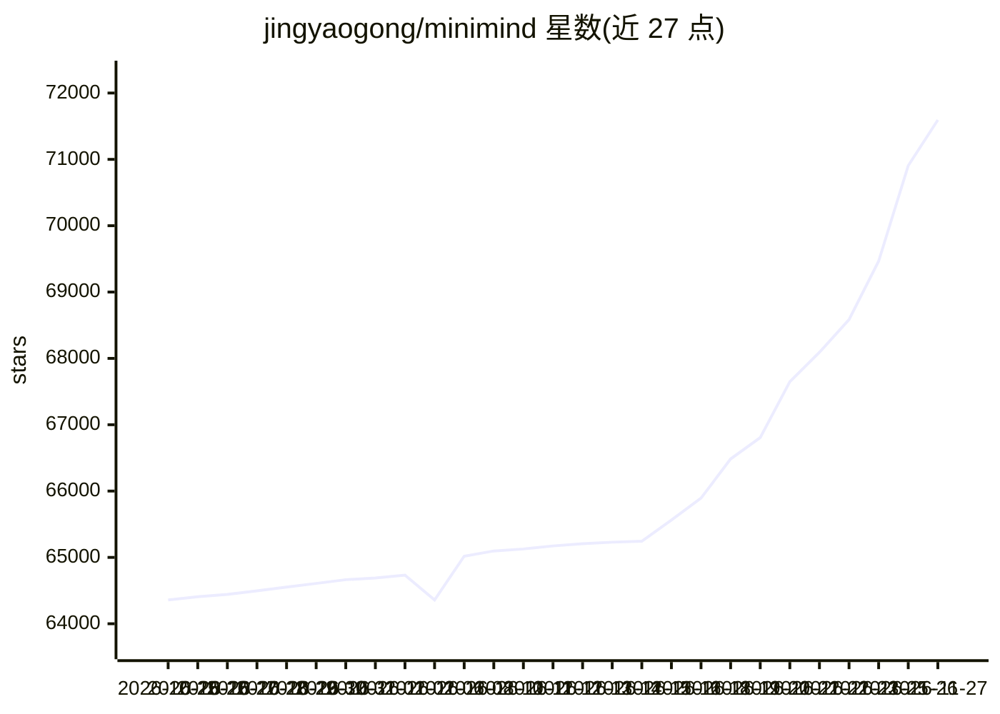

# jingyaogong/minimind

⭐ 71,594 · Python · Apache-2.0 · 推送 2026-11-26 · [GitHub](https://github.com/jingyaogong/minimind) · [官网](https://jingyaogong.github.io/minimind) · 个人维护 · 中文 README

**给LLM学习者：从0全流程训练64M小语言模型的可复现项目**

从0实现的小型语言模型训练项目，含 Dense 与 MoE 结构（主线对齐 Qwen3 生态），覆盖 Tokenizer 训练、预训练、SFT、LoRA、DPO、PPO/GRPO/CISPO 强化学习、Tool Use、Agentic RL、蒸馏等阶段，全部核心算法用 PyTorch 原生实现，不依赖第三方高层封装。作者实测单张 RTX 3090 上 SFT 一个 epoch 约 2 小时。已发布 26M–198M 多个权重，兼容 transformers/trl/peft 与 llama.cpp/vllm/ollama 等生态，并扩展视觉与多模态变体。以教程+代码仓库形式提供，需自备 GPU 或云算力。

## 筛选速览

| 维度 | 判定 | 备注 |
|---|---|---|
| AI 角色 | `ai-native` | 本体是模型或模型工具 |
| 许可风险 | `permissive` | Apache-2.0 |
| 部署形态 | `library` | 以包/库形式分发 |
| 模型依赖 | local-ok | 支持本地模型 |
| 硬件要求 | — | 无带数字的原话,不猜 |
| 安装摩擦 | `medium` | 含编译或系统依赖之一 |
| 成熟度 | — | 结构信号不足 |

## 动量与使用信号

- 维护:`active` — 距上次 push 25.6 天,年发版 1,19 位贡献者
- 涨星:近 1 天 **+63**(自 20261016 起算)
- 安装:pypi 包 `streamlit` 月下载 19,368,322
- 平台:WEB · 协议:OPENAI-API / OLLAMA

## 能力要点

- 覆盖 Pretrain/SFT/LoRA/DPO/PPO/GRPO/CISPO/蒸馏全流程训练代码
- 核心算法 PyTorch 从 0 实现，不依赖第三方高层抽象
- 兼容 transformers、trl、peft 与 llama.cpp、vllm、ollama 推理引擎
- 提供兼容 OpenAI API 协议的服务端与 Streamlit 聊天 WebUI

## 适用场景

- 从零跑通一个小语言模型的预训练、微调与强化学习全流程
- 在个人 GPU 上低成本复现 LLM 训练以理解内部机制
- 将训练好的模型接入 FastGPT、Open-WebUI 等第三方 Chat UI
- 在 C-Eval、C-MMLU 等测评集上评测自训模型

## 场景标签

`模型评测` `教程课程` `微调` `模型训练` · 领域:评测与运维

## 证据(README 行号)

> L16: * 此开源项目旨在完全从 0 开始，仅用 3 块钱成本与 2 小时训练时间，即可训练出规模约为 64M 的超小语言模型 MiniMind。
> L21: * 这不仅是一个大语言模型全阶段开源复现项目，也是一套面向 LLM 入门与实践的教程。
> L66: - 覆盖 Pretrain、SFT、LoRA、RLHF-DPO、RLAIF（PPO / GRPO / CISPO）、Tool Use、Agentic RL、自适应思考与模型蒸馏等完整训练流程。

## 星数曲线

2026-10-25 64,358 → 2026-11-27 71,594（+7,236）

---
*卡片 v1 · prompt 1.4 · 生成 2026-11-24 · 置信度 high · 依据 README sha `e8a3a888255c` · [字段定义](../../DATASET.md)*
