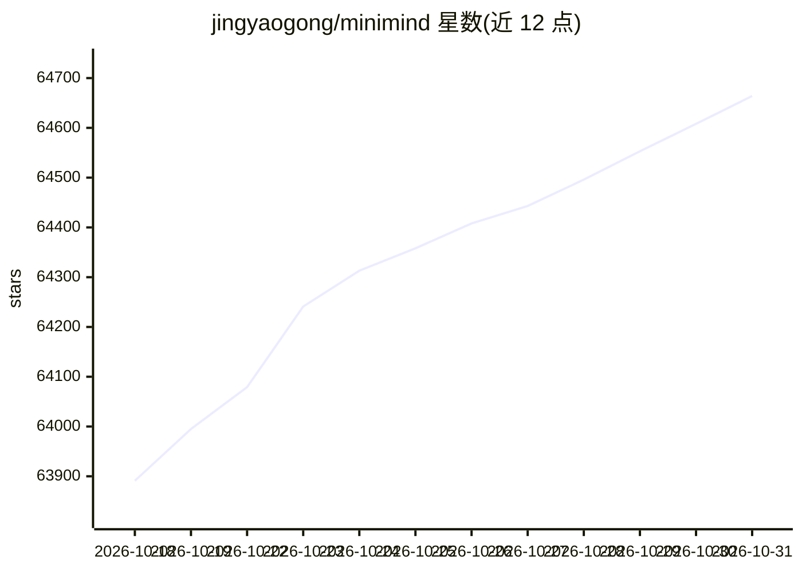

# jingyaogong/minimind

⭐ 64,664 · Python · Apache-2.0 · 推送 2026-10-27 · [GitHub](https://github.com/jingyaogong/minimind) · [官网](https://jingyaogong.github.io/minimind) · 个人维护 · 中文 README

**从零训练 64M 超小语言模型的开源教程项目**

从 0 开始完整复现小语言模型训练的开源项目：核心算法用 PyTorch 原生实现，不依赖第三方高层封装，覆盖 MoE、数据清洗、预训练、SFT、LoRA、DPO、PPO/GRPO/CISPO、Tool Use、Agentic RL、自适应思考与模型蒸馏全流程。提供全阶段开源数据集、Streamlit 聊天 WebUI、兼容 OpenAI API 协议的服务端，模型结构对齐 Qwen3 生态，可被 transformers/llama.cpp/vllm/ollama 等框架加载。适合想亲手理解 LLM 训练链路的个人，单张 NVIDIA 3090 上 SFT 1 epoch 实测约 2 小时。

## 筛选速览

| 维度 | 判定 | 备注 |
|---|---|---|
| AI 角色 | `ai-native` | 本体是模型或模型工具 |
| 许可风险 | `permissive` | Apache-2.0 |
| 部署形态 | `library` | 以包/库形式分发 |
| 模型依赖 | local-ok | 支持本地模型 |
| 硬件要求 | — | 无带数字的原话,不猜 |
| 安装摩擦 | `medium` | 含编译或系统依赖之一 |
| 成熟度 | — | 结构信号不足 |

## 动量与使用信号

- 维护:`active` — 距上次 push 25.6 天,年发版 1,19 位贡献者
- 涨星:近 1 天 **+63**(自 20261016 起算)
- 安装:pypi 包 `streamlit` 月下载 19,368,322
- 平台:WEB · 协议:OPENAI-API / OLLAMA

## 能力要点

- 全训练链路代码从 0 用 PyTorch 原生实现，不依赖第三方框架封装
- 覆盖 Pretrain/SFT/LoRA/DPO/PPO/GRPO/CISPO/Tool Use/Agentic RL/蒸馏全流程
- 开源全阶段数据集，主线模型结构对齐 Qwen3/Qwen3-MoE 生态
- 兼容 transformers、llama.cpp、vllm、ollama 及 OpenAI API 协议服务端

## 适用场景

- 从零动手训练并复现一个极小语言模型，理解 LLM 内部机制
- 在个人 GPU 上跑通预训练、SFT 到强化学习的完整流程
- 接入 FastGPT、Open-WebUI 等聊天界面做本地推理实验

## 场景标签

`教程课程` `模型训练` `微调` `强化学习` · 领域:学习与行业

## 证据(README 行号)

> L16: * 此开源项目旨在完全从 0 开始，仅用 3 块钱成本与 2 小时训练时间，即可训练出规模约为 64M 的超小语言模型 MiniMind。
> L18: * 项目同时开源了大模型的极简结构与完整训练链路，覆盖 MoE、数据清洗、预训练（Pretrain）、监督微调（SFT）、LoRA、RLHF（DPO）、RLAIF（PPO / GRPO / CISPO）、Tool Use、Agen
> L20: * 项目所有核心算法代码均从 0 使用 PyTorch 原生实现，不依赖第三方库提供的高层抽象接口。

## 星数曲线

2026-10-18 63,891 → 2026-10-31 64,664（+773）

---
*卡片 v1 · prompt 1.4 · 生成 2026-10-18 · 置信度 high · 依据 README sha `1e4aa4e5511c` · [字段定义](../../DATASET.md)*
