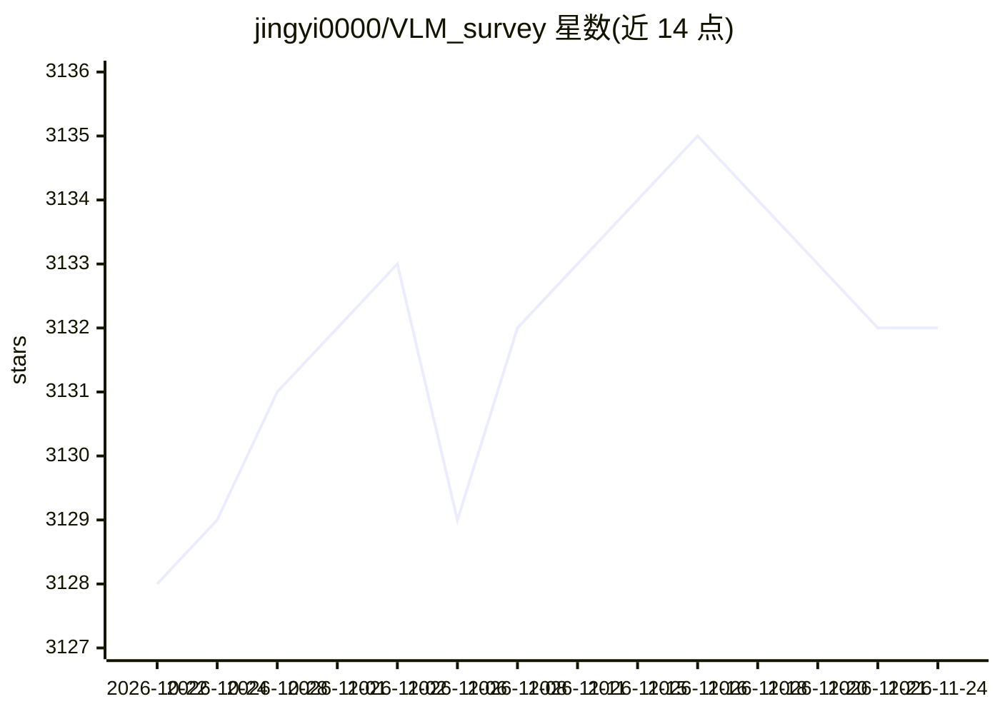

# jingyi0000/VLM_survey

⭐ 3,131 · 推送 2026-11-16 · [GitHub](https://github.com/jingyi0000/VLM_survey) · 组织维护

**面向科研者系统整理 VLM 视觉任务论文与数据集的清单**

配套 TPAMI 2024 综述论文《Vision-Language Models for Vision Tasks: A Survey》的论文集仓库：按 VLM 与合成数据、预训练方法、迁移学习（提示学习/测试时适配）、知识蒸馏（检测/分割等）分类收录论文条目，每条含论文链接、会议与代码/项目链接；另整理 VLM 预训练与评测数据集表格（图像分类、图文检索、动作识别、目标检测、语义分割）。接受 Pull Request 补充遗漏论文，README 给出贡献格式模板。

## 筛选速览

| 维度 | 判定 | 备注 |
|---|---|---|
| AI 角色 | `ai-knowledge` | 知识聚合/清单类 |
| 许可风险 | `none` | — |
| 部署形态 | `None` |  |
| 模型依赖 | — | README 未给出锁定关系 |
| 硬件要求 | — | 无带数字的原话,不猜 |
| 安装摩擦 | `low` | 无编译、无系统依赖或容器化 |
| 成熟度 | — | 结构信号不足 |

## 能力要点

- 按预训练/迁移学习/知识蒸馏等类别组织的 VLM 论文清单
- 收录 VLM 预训练与多任务评测数据集对照表
- 配套 TPAMI 2024 综述论文并提供引用条目
- 提供 PR 贡献格式模板，欢迎补充新论文

## 适用场景

- 查找某类视觉任务可用的 VLM 方法论文与代码
- 为 VLM 实验挑选预训练或评测数据集
- 跟踪视觉语言模型领域的最新会议论文

## 场景标签

`科研工具` `精选清单` · 领域:学习与行业

## 证据(README 行号)

> L3: This is the repository of **Vision Language Models for Vision Tasks: a Survey**, a systematic survey of VLM studies 
> L19: - b. Add the Title, Paper link, Conference, Project/Code link in `README.md` using the following format:

## 星数曲线

2026-10-22 3,128 → 2026-11-24 3,132（+4）

---
*卡片 v1 · prompt 1.4 · 生成 2026-11-23 · 置信度 high · 依据 README sha `e073cc205724` · [字段定义](../../DATASET.md)*
